# EVALUACIÓN SUMATIVA UNIDAD Nº 1
## DESARROLLO DE APLICACIONES MÓVILES

---

### DATOS DE IDENTIFICACIÓN
* **Institución:** Instituto Profesional San Sebastián (IPSS)
* **Carrera:** Ingeniería en Conectividad y Redes / Informática
* **Asignatura:** Desarrollo de Aplicaciones Móviles
* **Unidad Temática:** Unidad 1 – Introducción al Desarrollo Móvil y Frameworks Multiplataforma
* **Docente:** Boris Belmar
* **Estudiante(s):** Ain Catoni - Pía Alarcón
* **Año Lectivo:** 2026

---

## 1. INTRODUCCIÓN Y ALCANCE DEL PROYECTO

El presente proyecto corresponde al desarrollo de una aplicación móvil para la gestión de notas y tareas pendientes (**To-Do List**), diseñada e implementada sobre el ecosistema **React Native** con **Expo (SDK 58)** y **TypeScript**. La solución permite a los usuarios registrar, visualizar, editar y eliminar tareas de manera fluida, cumpliendo rigurosamente con los requisitos funcionales del encargo y los estándares de calidad visual y arquitectónica estipulados en la rúbrica de evaluación.

### Objetivos Principales:
1. Desarrollar un sistema de gestión de tareas con operaciones completas **CRUD** (Crear, Leer, Actualizar y Eliminar).
2. Estructurar cada elemento de información mediante un modelo formal compuesto por `id`, `title`, `description`, `completed`, `createdAt` y `updatedAt`.
3. Implementar una interfaz gráfica móvil reactiva que respete principios ergonómicos de usabilidad, jerarquía visual, contraste y ritmo espacial.
4. Gestionar el estado de manera desacoplada mediante un **Custom Hook** (`useTasks`) y persistencia local asíncrona a través de `@react-native-async-storage/async-storage`.

---

## 2. ARQUITECTURA Y CONCEPTOS FUNDAMENTALES DEL FRAMEWORK (INDICADOR 1 - 14 PTS)

React Native es un marco de desarrollo móvil multiplataforma que permite compilar código JavaScript/TypeScript en componentes de interfaz nativos tanto para **iOS** como para **Android**, garantizando un rendimiento cercano a las aplicaciones desarrolladas en Swift o Kotlin.

```
+-------------------------------------------------------------------+
|                     CAPA DE JAVASCRIPT / REACT                     |
|  - Componentes (Header, TaskItem, TaskModal, TaskFilterBar)       |
|  - Custom Hook (useTasks) y Estado Reactivo (useState, useMemo)   |
|  - Tipado Estricto TypeScript (Task, TaskFilter, TaskFormData)     |
+-------------------------------------------------------------------+
                                  │
                                  ▼ (JSI - JavaScript Interface)
+-------------------------------------------------------------------+
|               NUEVA ARQUITECTURA (REACT NATIVE SDK 58)             |
|  ┌─────────────────────────────┐   ┌───────────────────────────┐  |
|  │       Fabric Renderer       │   │       TurboModules        │  |
|  │  (Renderizado Directo C++)  │   │  (Llamadas Nativas Sync)  │  |
|  └─────────────────────────────┘   └───────────────────────────┘  |
|                      Motor Hermes (Bytecode AOT)                  |
+-------------------------------------------------------------------+
                                  │
                                  ▼
+-------------------------------------------------------------------+
|                    CAPA NATIVA DEL SISTEMA OPERATIVO              |
|        iOS: UIView, UITextField, UIAccessibility, UIAlert         |
|      Android: View, EditText, AccessibilityDelegate, Dialog       |
+-------------------------------------------------------------------+
```

### 2.1. Arquitectura de Nueva Generación (Fabric & TurboModules en SDK 58)
A diferencia de las versiones históricas de React Native que dependían de un "puente asíncrono serializado en JSON" (The Bridge) —el cual introducía cuellos de botella en listas con gran densidad de datos—, **Expo SDK 58** ejecuta la **Nueva Arquitectura por defecto**:
1. **JavaScript Interface (JSI):** Enlace directo en C++ entre el hilo de JavaScript y el entorno nativo del host, permitiendo llamadas síncronas de memoria compartida sin serialización de cadenas JSON.
2. **Fabric Renderer:** Sistema de renderizado en C++ que unifica la creación de árboles de componentes nativos, posibilitando transiciones visuales inmediatas y renderizado concurrente de React 19.
3. **TurboModules:** Carga perezosa (*lazy loading*) de módulos nativos del dispositivo (sensores, almacenamiento, hápticos), mejorando el tiempo de arranque de la aplicación.
4. **Hermes Engine:** Motor JavaScript optimizado para dispositivos móviles que compila el código fuente a bytecode en tiempo de construcción (*Ahead-of-Time*), reduciendo el consumo de memoria RAM y el tiempo de inicio en frío (*Time to Interactive*).

### 2.2. Componentes Clave y Terminología Técnica

| Componente / Concepto | Rol en la Arquitectura | Aplicación Concreta en el Proyecto |
| :--- | :--- | :--- |
| **`View`** | Contenedor estructural nativo equivalente a `<div>` en web o `UIView`/`ViewGroup`. | Estructuración de tarjetas de tareas, filas de acciones y contenedores modales. |
| **`Text`** | Componente nativo de renderizado tipográfico accesible. | Despliegue de títulos jerárquicos, descripciones y badges temporales. |
| **`TextInput`** | Control nativo de entrada de texto interactivo con eventos de teclado. | Formulario de captura para `title` y `description` con autoenfoque y límite de caracteres. |
| **`Pressable`** | Primitiva táctil avanzada que provee estados `pressed`, `hover` y accesibilidad. | Botones de agregar, editar, eliminar y checkbox de completado con feedback visual táctil. |
| **`FlatList`** | Lista virtualizada que recicla vistas en memoria para alto rendimiento en pantallas móviles. | Renderizado eficiente de las tareas filtradas, integrando `keyExtractor` y `ListEmptyComponent`. |
| **`Modal`** | Vista superpuesta nativa presentada sobre el contexto actual. | Diálogo accesible para creación y edición de tareas sin navegación forzada. |
| **`Alert`** | Invocación al diálogo de sistema nativo (`UIAlertController` en iOS / `AlertDialog` en Android). | Confirmación destructiva antes de eliminar permanentemente una tarea. |
| **`SafeAreaView`** | Contenedor que calcula los márgenes físicos (*insets*) del dispositivo. | Protección de la interfaz contra colisiones con la barra de estado y la Dynamic Island. |

---

## 3. PATRONES DE DISEÑO IMPLEMENTADOS (INDICADOR 2 - 18 PTS)

Para garantizar mantenibilidad, testabilidad y escalabilidad, el proyecto implementa patrones de diseño centrales del desarrollo en React y React Native:

### 3.1. Patrón Custom Hook (Separación de Negocio y Presentación)
La lógica de negocio, validación, cálculo de métricas y persistencia asíncrona se encuentra totalmente encapsulada en el hook personalizado `useTasks()`. Los componentes visuales consumen únicamente funciones e interfaces, sin acoplamiento a las APIs de almacenamiento:

```typescript
// src/hooks/useTasks.ts
export function useTasks() {
  const [tasks, setTasks] = useState<Task[]>([]);
  const [filter, setFilter] = useState<TaskFilter>('all');

  const addTask = useCallback(async (title: string, description: string) => {
    const newTask: Task = {
      id: `task_${Date.now()}_${Math.random().toString(36).substring(2, 9)}`,
      title: title.trim(),
      description: description.trim(),
      completed: false,
      createdAt: Date.now(),
    };
    const updated = [newTask, ...tasks];
    await persist(updated);
    return true;
  }, [tasks, persist]);

  return { tasks, filteredTasks, addTask, editTask, toggleTask, deleteTask, stats };
}
```

### 3.2. Patrón Container / Presentational Components
* **Componentes Presentacionales (Puros):** `Header`, `TaskItem`, `TaskFilterBar` y `EmptyState` reciben sus datos exclusivamente por `props` y emiten eventos mediante callbacks tipados. No tienen efectos colaterales.
* **Componente Contenedor (Orquestador):** `App.tsx` orquesta el ciclo de vida, la visibilidad de los diálogos y la inyección de dependencias entre el hook y los componentes hijos.

### 3.3. Patrón de Componentes Controlados (Controlled Components)
En el formulario modal (`TaskModal.tsx`), el estado de los inputs de texto está sincronizado bidireccionalmente con el estado local de React, lo que permite validación reactiva en tiempo real, conteo de caracteres remanentes y limpieza inmediata tras el envío:

```typescript
// src/components/TaskModal.tsx
<TextInput
  style={[styles.input, Boolean(errorMessage) && styles.inputError]}
  value={title}
  onChangeText={(text) => {
    setTitle(text);
    if (errorMessage) setErrorMessage('');
  }}
  placeholder="Título de la tarea"
  maxLength={80}
/>
```

### 3.4. Flujo de Datos Unidireccional e Inmutabilidad
Todas las mutaciones de datos en la colección de tareas se realizan mediante operaciones inmutables (`map`, `filter`, spread operator `[...]`), previniendo estados inconsistentes o bugs de re-renderizado:

```typescript
// Eliminación inmutable
const updated = tasks.filter((t) => t.id !== id);
// Edición inmutable
const updated = tasks.map((t) => t.id === id ? { ...t, title, description, updatedAt: Date.now() } : t);
```

---

## 4. PRINCIPIOS DE DISEÑO DE UI MÓVIL APLICADOS (INDICADOR 3 - 12 PTS)

La interfaz fue construida siguiendo los estándares de diseño contemporáneos para sistemas operativos móviles (**Apple Human Interface Guidelines** y **Material Design 3**):

```
+-------------------------------------------------------------+
| [EVA1 • IPSS 2026]                                          | <- Tag jerárquico secundario
| Mis Notas y Tareas                       [+ Nueva] (Primario)| <- H1 prominente + Botón acento
| 2 pendientes de 3                                           | <- Subtítulo informativo
+-------------------------------------------------------------+
| [ Q Buscar tareas...                           ]            | <- Input con icono y affordance
| [ Todas (3) ]  [ Pendientes (2) ]  [ Completadas (1) ]      | <- Segmented bar (Ritmo 8pt)
+-------------------------------------------------------------+
| +---------------------------------------------------------+ |
| | [ ] Diseñar interfaz de usuario (UI)       [✎] [🗑]    | | <- Card con contraste elevado
| |     Implementar lista, modales y feedback...           | | <- Descripción atenuada
| |     ⏱ 10:45 AM                                          | | <- Timestamp secundario
| +---------------------------------------------------------+ |
|                                             ┌───────────┐   |
|                                             │  ( + )    │   | <- FAB flotante ergonómico
|                                             └───────────┘   |    (Área táctil ≥ 48pt)
+-------------------------------------------------------------+
```

1. **Jerarquía Visual:**
   * Títulos en peso extra-negrita (`fontWeight: '800'`) y tamaño 24pt para anclaje visual primario.
   * Descripciones en tono pizarra (`#475569`, 14pt) y metadatos en tipografía pequeña (`#94A3B8`, 11pt).
   * Distinción clara entre tareas pendientes (activas con fondo blanco) y tareas completadas (fondo tenue `#F8FAFC`, texto tachado `line-through` y opacidad reducida).
2. **Balance y Espacio en Blanco:**
   * Márgenes laterales simétricos de 20pt que evitan saturación en bordes de pantalla curva o redondeada.
   * Separación vertical entre tarjetas mediante `marginBottom: 12pt`.
3. **Contraste Accesible (WCAG 2.1 AA):**
   * Texto de alto contraste `#0F172A` sobre fondos blancos `#FFFFFF` (ratio de contraste superior a 12:1).
   * Color acento `#2563EB` (Azul Real) para acciones primarias constructivas.
   * Color semántico `#10B981` (Verde Esmeralda) para confirmación de tareas completadas.
   * Color destructivo `#DC2626` (Rojo Carmesí) claramente diferenciado para la acción de eliminación.
4. **Ritmo y Proporción (Grid de 8 Puntos):**
   * Todas las dimensiones, paddings, gaps y radios de borde se calculan en múltiplos estándar (4pt, 8pt, 12pt, 16pt, 24pt).
   * Radio de curvatura de 14pt en tarjetas y 24pt en botones píldora.
5. **Ergonomía Táctil (*Touch Target Sizes*):**
   * Todos los elementos interactivos (checkbox, botón de eliminar, botón de editar y botón flotante) poseen áreas mínimas de contacto de **44x44 pt** o superiores, previniendo pulsaciones accidentales.

---

## 5. IMPLEMENTACIÓN DE COMPONENTES DE UI Y FUNCIONALIDADES (INDICADOR 4 - 28 PTS)

La aplicación integra de forma robusta todos los requerimientos obligatorios de la rúbrica y las características del encargo sumativo:

### 5.1. Lista de Tareas y Renderizado Dinámico
* Se utiliza `FlatList` con optimización de memoria.
* Cada tarea muestra su título, descripción detallada, fecha/hora formateada localmente en español de Chile (`es-CL`) y badge de modificación si fue editada.
* Selector de alternancia (checkbox táctil) con icono de confirmación vectorial `Ionicons`.

### 5.2. Formulario de Captura y Edición (Modal Dual)
* **Modo Creación:** Abre el formulario con inputs limpios y foco automático en el título.
* **Modo Edición:** Pre-carga el título y la descripción existentes de la tarea seleccionada.
* **Limpieza de Campos:** Tras registrar exitosamente una tarea, los campos se vacían automáticamente y el modal se cierra de forma fluida.
* **Control de Teclado:** Se implementa `KeyboardAvoidingView` adaptativa según el sistema operativo (`padding` en iOS y `height` en Android) para evitar que el teclado cubra los botones de acción.

### 5.3. Eliminación Segura con Confirmación Nativa
* Cada elemento de la lista cuenta con un botón de eliminar con icono de cesto de basura (`trash-outline`).
* Al presionarlo, la app no borra inmediatamente; dispara un diálogo nativo `Alert.alert` que exige confirmación explícita del usuario (`Cancelar` / `Eliminar`), protegiendo al usuario de pérdidas accidentales de datos.

### 5.4. Barra de Filtros y Búsqueda en Vivo
* Pestañas segmentadas con contadores en tiempo real: **Todas**, **Pendientes** y **Completadas**.
* Barra de búsqueda reactiva que filtra por coincidencia de texto tanto en el título como en la descripción de las tareas.

---

## 6. USABILIDAD Y EXPERIENCIA DE USUARIO (INDICADOR 5 - 28 PTS)

1. **Affordance y Microinteracciones:**
   * Los botones utilizan la propiedad `pressed` de `Pressable` para proveer retroalimentación visual inmediata (reducción de escala sutil `transform: [{ scale: 0.95 }]` y atenuación de opacidad).
2. **Prevención y Manejo de Errores:**
   * Si el usuario intenta guardar una tarea con el título vacío o compuesto solo por espacios, se despliega un banner de validación en color rojo dentro del modal (`"El título de la tarea es obligatorio"`), sin cerrar el formulario ni perder el contenido de la descripción.
3. **Estados Vacíos (*Empty States* Contextuales):**
   * El componente `EmptyState` muestra un icono y mensaje diferenciado según la situación del usuario:
     * Si no hay ninguna tarea: invita a crear la primera nota con un botón directo.
     * Si no hay pendientes: felicita al usuario por tener sus pendientes al día.
     * Si no hay tareas completadas: orienta sobre cómo marcar una tarea.
     * Si la búsqueda no arroja resultados: ofrece un botón para limpiar el texto buscado.
4. **Persistencia Local y Resiliencia:**
   * Los datos se almacenan en el almacenamiento local del dispositivo mediante `AsyncStorage` bajo la clave `@ipss_todo_app:tasks_v1`. Al cerrar o reiniciar la aplicación, los datos se preservan intactos.
   * Se incluye un mecanismo de inicialización controlada (*seed data*) con tareas demostrativas al ejecutar por primera vez.

---

## 7. ESTRUCTURA DEL PROYECTO

```
Entrega/todo-notes-app/
├── App.tsx                     # Orquestador raíz con SafeAreaProvider y StatusBar
├── app.json                    # Manifiesto de configuración de Expo
├── package.json                # Dependencias (Expo 58, React 19, TypeScript)
├── tsconfig.json               # Configuración estricta de TypeScript
├── bun.lock                    # Bloqueo de dependencias de alta velocidad
├── assets/                     # Recursos gráficos (iconos, splash)
└── src/
    ├── types/
    │   └── task.ts             # Interfaces formales (Task, TaskFilter, TaskFormData)
    ├── storage/
    │   └── taskStorage.ts      # Capa de abstracción y persistencia AsyncStorage
    ├── hooks/
    │   └── useTasks.ts         # Custom Hook con lógica CRUD, filtros y estadísticas
    └── components/
        ├── Header.tsx          # Barra superior con métricas y botón de nueva tarea
        ├── TaskFilterBar.tsx   # Barra de búsqueda y selector de filtros segmentado
        ├── TaskItem.tsx        # Tarjeta de tarea con toggle, edición y borrado
        ├── TaskModal.tsx       # Formulario modal para creación y edición
        └── EmptyState.tsx      # Vistas ilustradas para estados sin datos
```

---

## 8. GUÍA DE INSTALACIÓN Y EJECUCIÓN PASO A PASO

### Requisitos Previos
* **Node.js** v20 o superior (verificado con Node `v22.23.1`).
* **Bun** instalado en el sistema (`v1.3.11`).
* Dispositivo móvil con la aplicación **Expo Go** instalada (SDK 58) o simulador de iOS/Android configurado.

### Paso 1: Clonar / Posicionarse en la Carpeta del Proyecto
```bash
cd Entrega/todo-notes-app
```

### Paso 2: Instalación de Dependencias
Gracias a Bun, la instalación de todas las dependencias toma menos de 4 segundos:
```bash
bun install
```

### Paso 3: Iniciar el Servidor de Desarrollo Expo
```bash
bun start
```
*(Alternativamente: `npx expo start`)*

### Paso 4: Visualización de la Aplicación
1. **En Teléfono Físico (Recomendado):**
   * Abre la cámara en iOS o la aplicación **Expo Go** en Android.
   * Escanea el código QR proyectado en la terminal.
   * La aplicación se compilará y abrirá directamente en el teléfono.
2. **En Simulador iOS (macOS):**
   * Con el servidor corriendo en la terminal, presiona la tecla `i`.
   * Expo iniciará automáticamente el simulador de iPhone configurado en Xcode.
3. **En Emulador Android:**
   * Con un emulador de Android Studio activo, presiona la tecla `a`.
4. **Verificación de Tipado Estricto:**
   ```bash
   bun run tsc --noEmit
   ```
5. **Ejecución de Pruebas Unitarias Automatizadas (TDD):**
   ```bash
   bun test
   ```
   *Ejecuta 13 pruebas unitarias en ~10ms validando la lógica completa de creación, validación, mutación inmutable, filtros y estadísticas.*

---

## 9. EVIDENCIAS DEL PROCESO Y CAPTURAS DE PANTALLA

A continuación se documenta el ciclo de desarrollo completo mediante el registro fotográfico de la preparación del entorno, compilación y validación funcional en el dispositivo iPhone (mediante Duplicación de iPhone / Expo Go SDK 58):

### 9.1. Preparación del Entorno de Desarrollo, CLI y Pruebas TDD

| # | Fase / Acción | Descripción Técnica | Captura |
| :---: | :--- | :--- | :---: |
| **01** | Instalación de Watchman | Invocación de Homebrew para instalar el monitor de archivos requerido por Metro. | [Ver Captura](Capturas/01.png) |
| **02** | Dependencias de Watchman | Descarga e instalación de librerías nativas (`folly`, `edencommon`, `pcre2`). | [Ver Captura](Capturas/02.png) |
| **03** | Autenticación Expo CLI | Inicio de sesión interactivo en la cuenta de Expo vía `npx expo login`. | [Ver Captura](Capturas/03.png) |
| **04** | Creación del Proyecto | Inicialización con `bun create expo` seleccionando la plantilla TypeScript y SDK 58 en 3.73s. | [Ver Captura](Capturas/04.png) |
| **05** | Configuración de Repositorio | Navegación a `todo-notes-app` y verificación del estado del repositorio Git. | [Ver Captura](Capturas/05.png) |
| **06** | Servidor Metro Bundler | Ejecución de `bun start` desplegando el código QR para vinculación con Expo Go. | [Ver Captura](Capturas/06.png) |
| **16** | Ejecución Suite TDD | Ejecución de `bun test` validando las 13 pruebas unitarias automatizadas con 0 fallos. | [Ver Captura](Capturas/16.png) |

---

### 9.2. Demostración en Video y Funcionamiento en Dispositivo Móvil

#### Registro en Video de la Aplicación en Ejecución
Se incluye la grabación de pantalla directa desde el iPhone evidenciando la fluidez, la apertura de modales, la edición, eliminación con alerta nativa y persistencia:

* 📱 **Video Demostrativo en iPhone (YouTube):** [https://youtube.com/shorts/k3e_sxzy7Bc](https://youtube.com/shorts/k3e_sxzy7Bc)
* 🎙️ **Video Explicativo / Defensa Técnica (YouTube):** *(Enlace disponible una vez grabado)*
* 💾 **Archivo de Respaldo Local:** [Capturas/demo-video.mp4](Capturas/demo-video.mp4)
---

#### Vista General de la Aplicación (iPhone / Expo Go SDK 58)

<p align="center">
  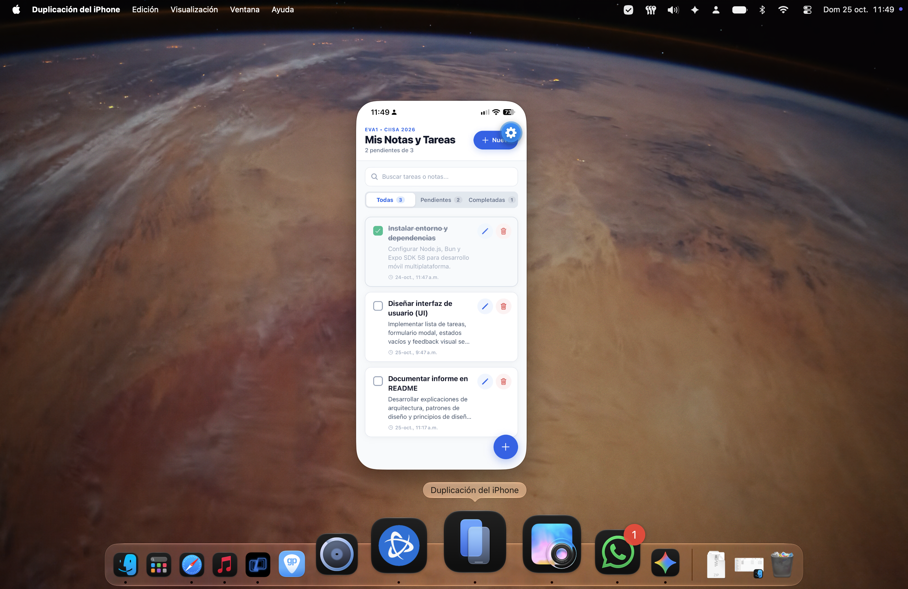
  <br/>
  <em>Captura 07: Aplicación To-Do ejecutándose en tiempo real en iPhone mediante Expo Go SDK 58 (Cabecera oficial IPSS 2026).</em>
</p>

---

#### Validación del Ciclo CRUD Principal

| Operación Evaluada | Captura | Descripción del Comportamiento Observable |
| :--- | :---: | :--- |
| **Editar Tarea (Formulario)** | 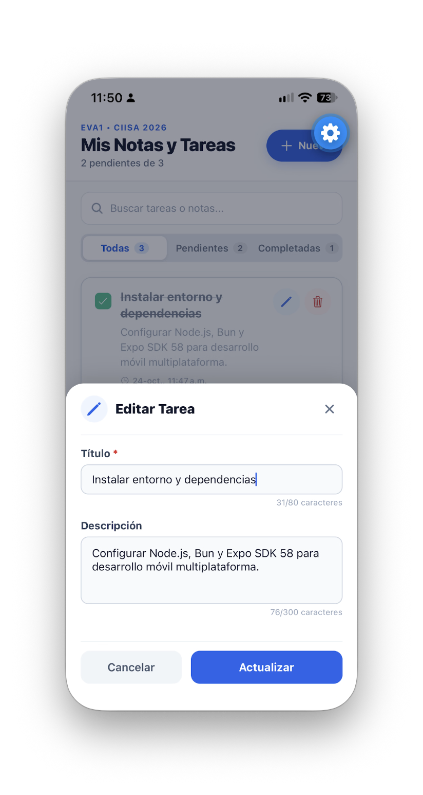 | Modal emergente con datos precargados (`title` y `description`), contador de caracteres y botón "Actualizar". |
| **Tarea Editada y Completada** | 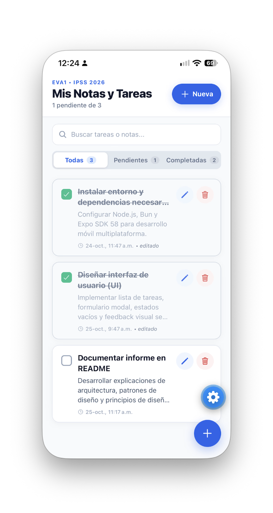 | Lista actualizada con el badge `• editado`, título tachado y contador de pendientes decrementado a 1. |
| **Crear Tarea (Formulario)** | 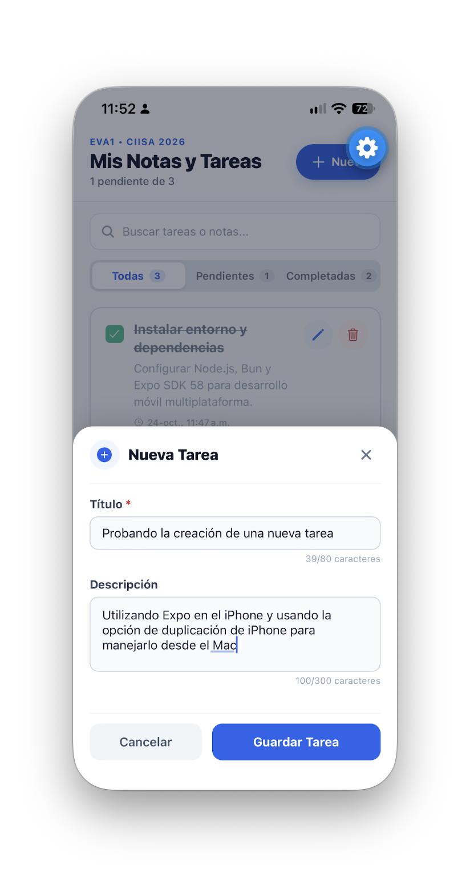 | Modal "Nueva Tarea" con campos limpios y foco activo para registrar una nueva nota. |
| **Inserción Exitosa en Lista** | 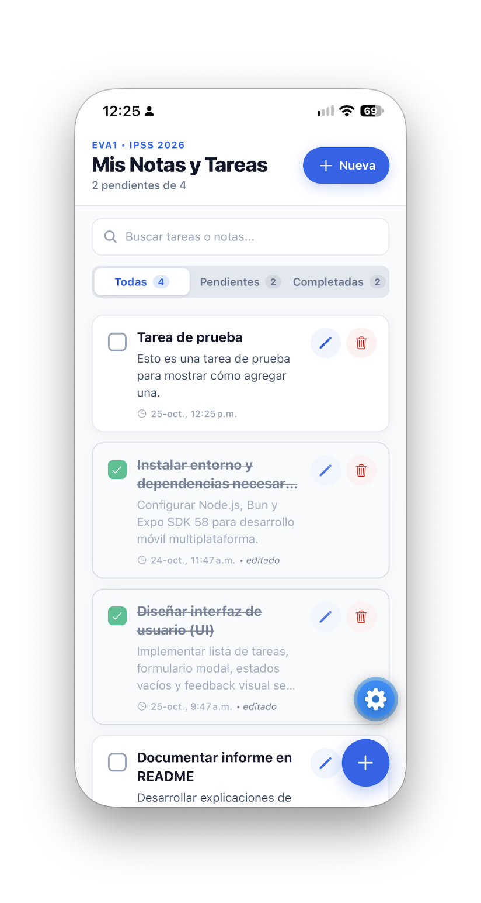 | La nueva tarea aparece en la cabecera de la lista, actualizando el total a 4 tareas (2 pendientes). |
| **Eliminación con Diálogo Nativo** | 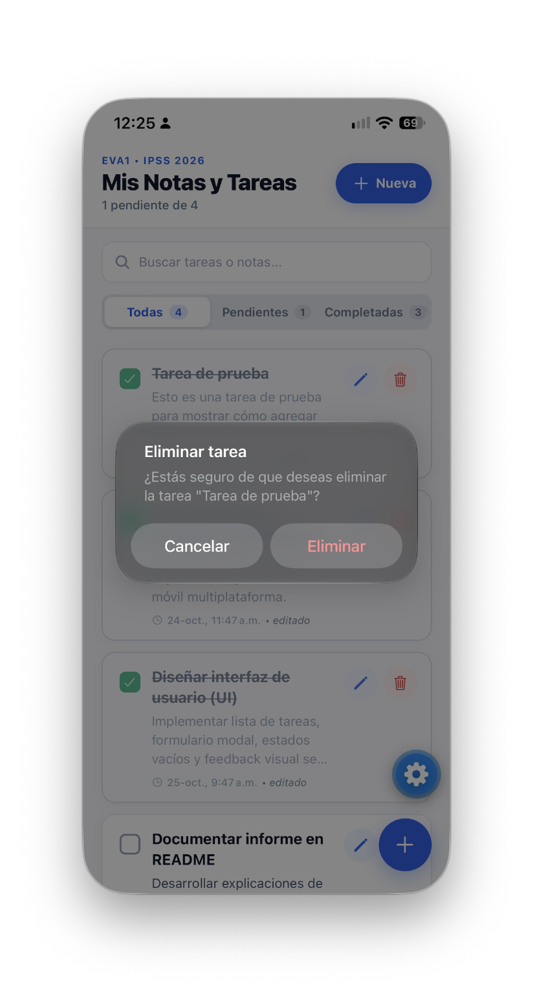 | Confirmación de seguridad mediante `Alert.alert` nativo de iOS evitando eliminaciones accidentales. |
| **Lista tras Eliminación** |  | Tarea de prueba removida de memoria y `AsyncStorage`, restableciendo el contador total a 3. |
| **Filtro: Solo Pendientes** | 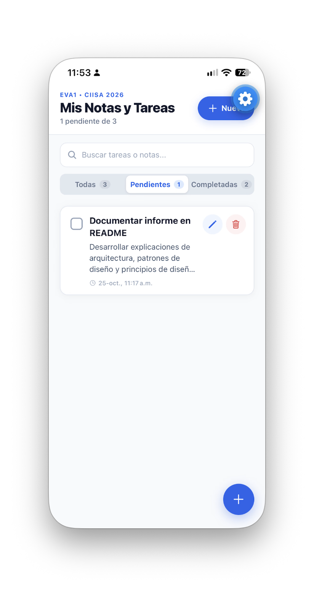 | Pestaña "Pendientes (1)" activa, aislando las tareas que aún requieren atención. |
| **Filtro: Solo Completadas** | 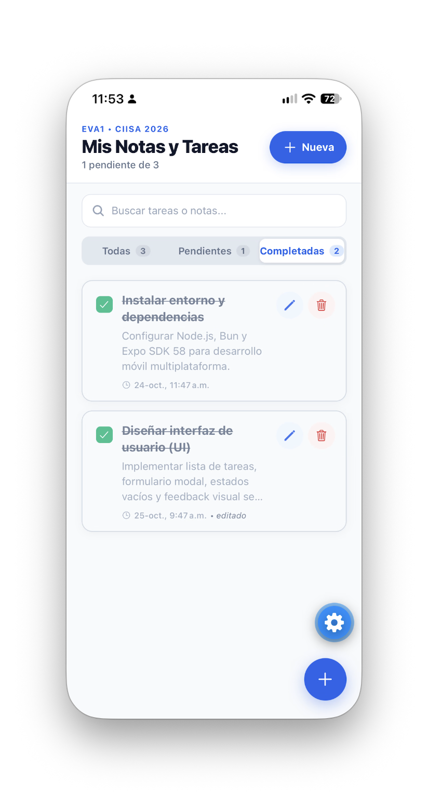 | Pestaña "Completadas (2)" activa, desplegando exclusivamente las tareas finalizadas con estilo atenuado. |

---

### 9.3. Validación de Errores, Robustez y Flexibilidad de UI

| Escenario de Prueba | Captura | Comportamiento y Principio de Usabilidad Demostrado |
| :--- | :---: | :--- |
| **Prevención de Error al Crear** | 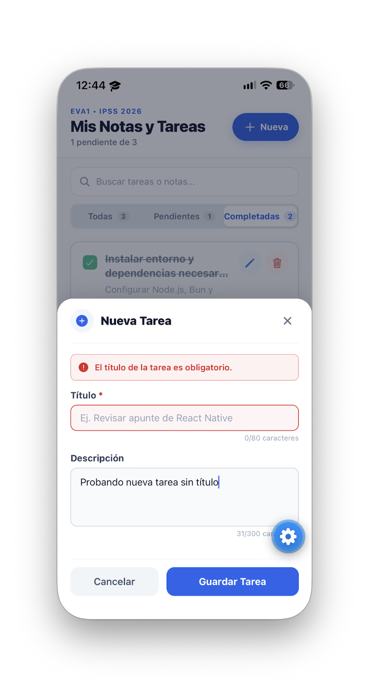 | Banner de error reactivo *"El título de la tarea es obligatorio"* al intentar guardar sin título. Evita registros vacíos. |
| **Flexibilidad de Entrada (Sin descripción)** | 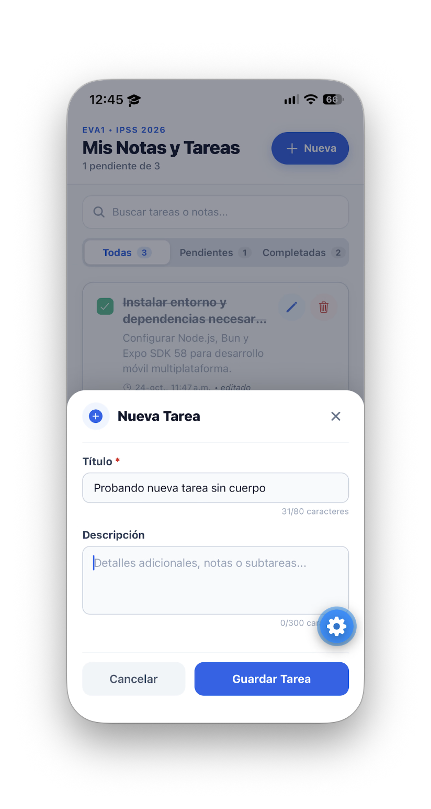 | Permite registrar tareas rápidas ingresando solo el título. |
| **Adaptabilidad Visual de Tarjeta** | 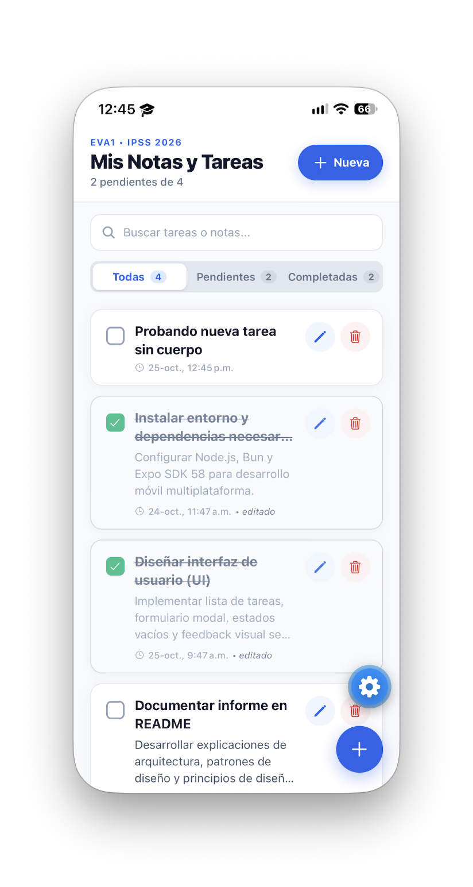 | La tarjeta se ajusta estéticamente sin espacios vacíos innecesarios cuando no hay descripción. |
| **Prevención de Error al Editar** | 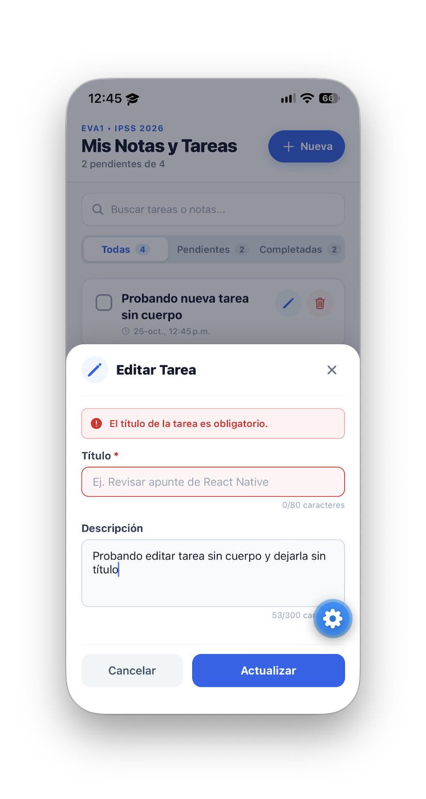 | Si el usuario borra el título en modo edición y presiona "Actualizar", el sistema rechaza la operación e indica el error. |

---

## 10. CONCLUSIONES Y PROYECCIÓN A SIGUIENTES UNIDADES

La solución implementada consolida el aprendizaje de la Unidad 1 al materializar una aplicación móvil multiplataforma completa, modular y alineada con los estándares de la industria moderna. El uso de React Native con Expo SDK 58 permitió desacoplar la interfaz de usuario en componentes reutilizables y garantizar un alto estándar de rendimiento.

De acuerdo a las especificaciones del curso, la arquitectura modular implementada en esta entrega deja preparada la aplicación para su futura extensión en las Unidades 2 y 3, facilitando la incorporación de:
1. Autenticación de usuarios y sincronización con servicios en la nube (Firebase / Supabase).
2. Conexión con APIs REST externas para persistencia remota.
3. Notificaciones push locales para recordatorios de tareas programadas.
