# EVALUACIÓN SUMATIVA UNIDAD Nº 2 — *"Los recursos son muchos"*
## DESARROLLO DE APLICACIONES MÓVILES (`todo-notes-app` v2)

---

### DATOS DE IDENTIFICACIÓN
* **Institución:** Instituto Profesional San Sebastián (IPSS)
* **Asignatura:** Desarrollo de Aplicaciones Móviles
* **Unidad Temática:** Unidad 2 – Conexión con APIs Internas y Periféricos del Dispositivo
* **Docente:** Boris Marcelo Belmar Muñoz
* **Estudiantes:** Pía Alarcón - Ain Cortés
* **Año:** 2026
* **Base evolutiva:** `todo-notes-app` Unidad 1 (tag Git `entrega-u1`, rama de trabajo `unidad2`)

---

## 1. INTRODUCCIÓN, ALCANCE CONFIRMADO Y EQUIVALENCIA TECNOLÓGICA

### 1.1. Evolución desde la Unidad 1 y alcance de evaluación
Partiendo de la aplicación To-Do List de la Unidad 1 (CRUD local con React Native, Expo SDK 58 y TypeScript), esta entrega evoluciona el proyecto hacia una aplicación móvil **multiusuario, offline-first y orientada a APIs internas y periféricos del dispositivo**:

* **Alcance confirmado por el docente (19–20 nov 2026):** la evaluación se centra exclusivamente en la integración con **APIs internas del dispositivo** (cámara, galería, sistema de archivos privado, GPS/mapas, permisos nativos, almacenamiento local `AsyncStorage` y almacenamiento seguro `expo-secure-store`), operando **100 % dentro del dispositivo** incluso en modo avión, sin depender de servicios web externos.
* **Conservación sin regresiones:** se preservan todas las capacidades de la Unidad 1 (crear, editar, completar, eliminar con confirmación nativa, filtrar por estado y buscar en tiempo real), protegidas por la suite de regresión `src/__tests__/taskLogic.test.ts` (13 pruebas).

### 1.2. Justificación técnica del stack moderno (React Native + Expo SDK 58 vs. Ionic/Capacitor)
Aunque el enunciado referencial menciona Ionic/Capacitor, el proyecto se diseñó e implementó sobre **React Native 0.88 + Expo SDK 58** (React 19, TypeScript estricto y Bun) por razones técnicas y de vigencia en la industria móvil actual:

* **Renderizado nativo real frente a WebView:** a diferencia de Ionic/Capacitor (que envuelve una aplicación HTML/CSS dentro de un `WebView`), React Native compila la interfaz a componentes nativos reales del sistema operativo (`UIView` en iOS y `ViewGroup` en Android) mediante la **Nueva Arquitectura** (JSI en C++, *Fabric Renderer*, *TurboModules* y bytecode AOT en *Hermes*), ofreciendo menor latencia en listas, animaciones, teclado y periféricos.
* **Ecosistema moderno y soporte de primera mano para APIs del dispositivo:** Expo SDK 58 provee módulos nativos oficiales, tipados en TypeScript y mantenidos de forma unificada (`expo-image-picker`, `expo-location`, `expo-file-system`, `expo-secure-store`, `expo-network`), además de configuración declarativa de permisos en `app.json` (*Continuous Native Generation*).
* **Vigencia laboral y continuidad con la Unidad 1:** React Native + Expo es hoy uno de los estándares predominantes en desarrollo móvil multiplataforma y permite evolucionar directamente la base de `todo-notes-app` construida en la Unidad 1 sin reescribir la aplicación.

Para trazabilidad directa con los recursos solicitados en la evaluación, la siguiente tabla resume la equivalencia funcional:

| Recurso de referencia (Ionic/Capacitor) | Equivalente moderno en Expo SDK 58 | Rol técnico en `todo-notes-app` v2 |
| :--- | :--- | :--- |
| **`@capacitor/camera`** | **`expo-image-picker`** (`launchCameraAsync`, `launchImageLibraryAsync`) | Captura de fotos con cámara y selección desde galería con compresión (`quality: 0.7`). |
| **`@capacitor/geolocation`** | **`expo-location`** (`getCurrentPositionAsync`, `watchPositionAsync`, `enableNetworkProviderAsync`) | Captura automática de GPS al crear tarea, precisión en metros (`±m`), timeout propio de `10 s` y apertura en Mapas nativos. |
| **`@capacitor/preferences`** | **`@react-native-async-storage/async-storage`** | Persistencia local aislada por usuario (`tasks_v2:<userId>`, `users_v1`, `lastUser_v1`) y migración única U1→U2. |
| **`@capacitor/filesystem`** | **`expo-file-system`** (`File`, `Directory`, `Paths.document`) | Almacenamiento privado de imágenes en `photos/<userId>/<taskId>-<ts>.jpg` con limpieza automática al reemplazar o eliminar. |
| **Almacenamiento seguro de sesión** | **`expo-secure-store`** (Keychain iOS / Keystore Android) | Resguardo cifrado de la sesión activa (`session_v1`), persistente al reiniciar incluso en modo avión. |
| **Detección de red** | **`expo-network`** | Detección del estado de conectividad para continuidad offline. |
| **Pruebas unitarias (Jest/Jasmine)** | **`bun test --coverage`** | 155 pruebas TDD en ~30 ms con arquitectura de Puertos y Adaptadores y dobles de prueba (*fakes*). |

---

## 2. ARQUITECTURA DE PUERTOS Y ADAPTADORES

Para desacoplar completamente la lógica de negocio de las APIs nativas de Expo y garantizar una cobertura de pruebas automatizadas superior al 97 %, el proyecto aplica la arquitectura de **Puertos y Adaptadores (Arquitectura Hexagonal)**:

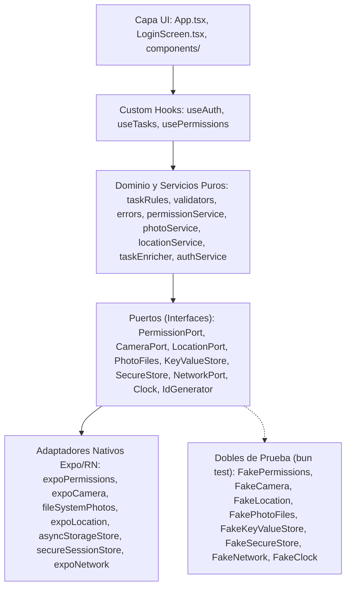

La capa `src/domain/`, `src/services/` y `src/storage/` **no importa** `react-native` ni módulos `expo-*`. La inyección de dependencias reales se centraliza en `src/composition.ts`.

### 2.1. Estructura de módulos del proyecto

```text
todo-notes-app/
├── App.tsx                              # AuthGate (LoginScreen <-> Lista de Tareas), FlatList optimizada
├── app.json                             # Plugins Expo SDK 58 y textos de permisos en español
├── bunfig.toml                          # Umbral mínimo de cobertura 80 % (domain/services/api/storage)
├── eslint.config.js                     # ESLint 9 + eslint-config-expo
├── Capturas/
│   ├── 01.png .. 21.png                 # Evidencias preservadas de Unidad 1
│   └── u2/                              # 18 capturas reales iOS (iPhone) y Android (OnePlus) de Unidad 2
├── docs/                                # Documentación viva (Brief.md, Domain.md, Stack.md, Plan.md)
└── src/
    ├── types/                           # task.ts, auth.ts (User, LocalAccount, Session), errors.ts
    ├── ports/                           # Interfaces de puertos (permissions, camera, photoFiles, location, storage, secureStore, network, clock, idGenerator, api)
    ├── domain/                          # validators.ts, taskRules.ts, errors.ts (13 AppErrorCode)
    ├── adapters/                        # expoPermissions, expoCamera, fileSystemPhotos, expoLocation, asyncStorageStore, secureSessionStore, expoNetwork, systemClock, defaultIdGenerator, http
    ├── api/                             # authApi.ts (createLocalAuthApi 100 % en dispositivo + createAuthApi para contratos)
    ├── storage/                         # taskStorage.ts (tasks_v2:<userId>, users_v1, lastUser_v1, migración U1→U2)
    ├── services/                        # permissionService, photoService, locationService, taskEnricher, authService
    ├── hooks/                           # useAuth, useTasks, usePermissions
    ├── screens/                         # LoginScreen.tsx (Iniciar sesión / Crear cuenta local)
    ├── components/                      # Header, TaskFilterBar, TaskItem (React.memo), TaskModal, EmptyState, PermissionRationale, PhotoPicker, PhotoPreviewModal, LocationBadge
    ├── composition.ts                   # Composición de adaptadores reales en dispositivo
    └── __tests__/
        ├── fakes/                       # 10 dobles de prueba en memoria + reloj simulado (FakeClock)
        ├── builders/                    # aTask(), aLocation(), aSession()
        ├── fixtures/                    # Payloads JSON de referencia
        └── *.test.ts                    # 10 suites TDD (155 pruebas automatizadas)
```

---

## 3. AUTENTICACIÓN LOCAL, ALMACENAMIENTO SEGURO Y MULTIUSUARIO

### 3.1. Diseño de seguridad y persistencia local (`R1`–`R4b`)
* **Sin sesión no hay acceso (`R1`):** `App.tsx` actúa como `AuthGate`; mientras no exista sesión válida en `expo-secure-store`, solo se renderiza `LoginScreen`.
* **Sesión cifrada en hardware (`R3`, `R4`):** los tokens de sesión (`session_v1`) se guardan exclusivamente en **`expo-secure-store`** (Keychain en iOS / Keystore en Android). Jamás se escriben en `AsyncStorage` (`lastUser_v1` solo almacena `{ id, username, displayName }`) ni en `console.*`.
* **Registro e inicio de sesión 100 % locales (`CU-01`, `CU-01b`, `R4b`):**
  * `LoginScreen` incorpora un selector segmentado **«Iniciar sesión» | «Crear cuenta»**, soporte para alias o correo electrónico (`/^[a-zA-Z0-9._@-]{3,30}$/`), contraseña (mínimo 6 caracteres) con botón mostrar/ocultar, validación de coincidencia al confirmar contraseña y detección de usuarios duplicados (*case-insensitive*).
  * Las cuentas se persisten en `users_v1` inicializando automáticamente las cuentas de prueba `emilys` y `michaelw`.
* **Aislamiento estricto por `userId` (`R2`):** cada usuario lee y escribe únicamente en `tasks_v2:<userId>` y guarda sus fotografías en `Paths.document/photos/<userId>/`. Al cerrar sesión (`Salir`), se eliminan los tokens de `SecureStore`, pero las tareas, fotos y cuentas locales permanecen intactas.
* **Migración automática U1 → U2:** al primer ingreso tras actualizar desde la Unidad 1, `taskStorage` detecta la clave heredada `@ipss_todo_app:tasks_v1`, migra las tareas reales (excluyendo semillas `seed-*`) una sola vez y marca `@ipss_todo_app:tasks_v1_migrated`.

### 3.2. Evidencias reales en iPhone (iOS) y OnePlus (Android)

| Escenario validado | iPhone (iOS) | OnePlus (Android) |
| :--- | :---: | :---: |
| **Pantalla de Acceso (`LoginScreen`)**<br/>Selector *Iniciar sesión / Crear cuenta*, ojito mostrar contraseña y chips rápidos `emilys (1)` / `michaelw (2)`. | 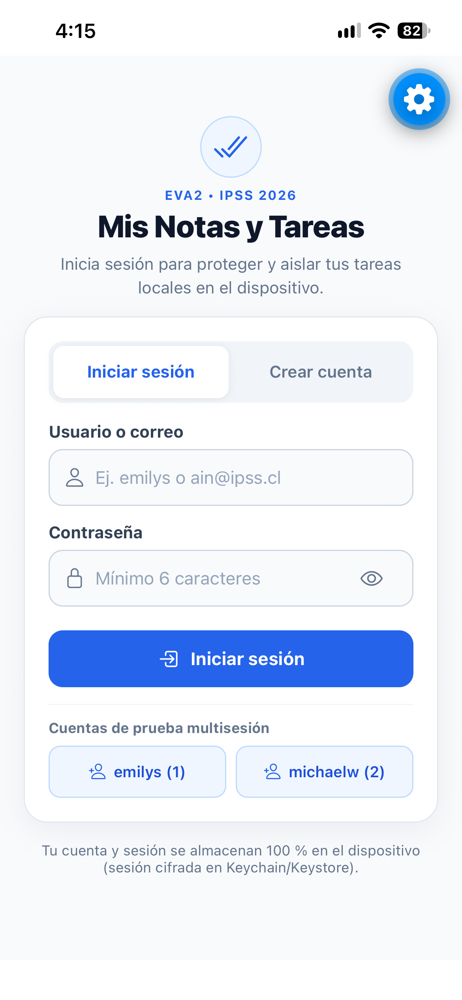 | 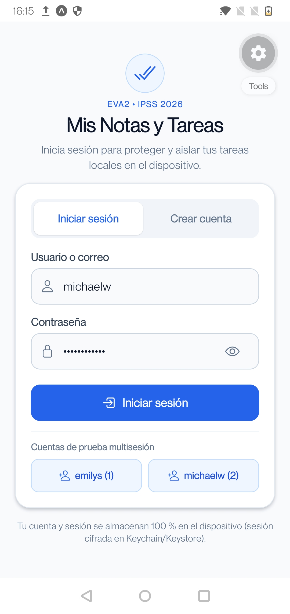 |
| **Registro local (`CU-01b`) y cuenta personalizada**<br/>Creación de cuenta `ain.catoni@gmail.com` en dispositivo y espacio aislado propio con badge limpio en cabecera. | 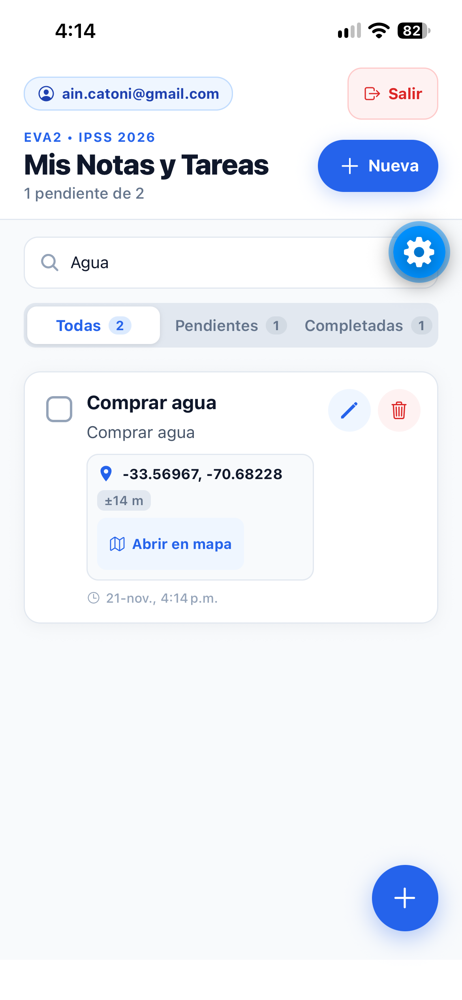 | 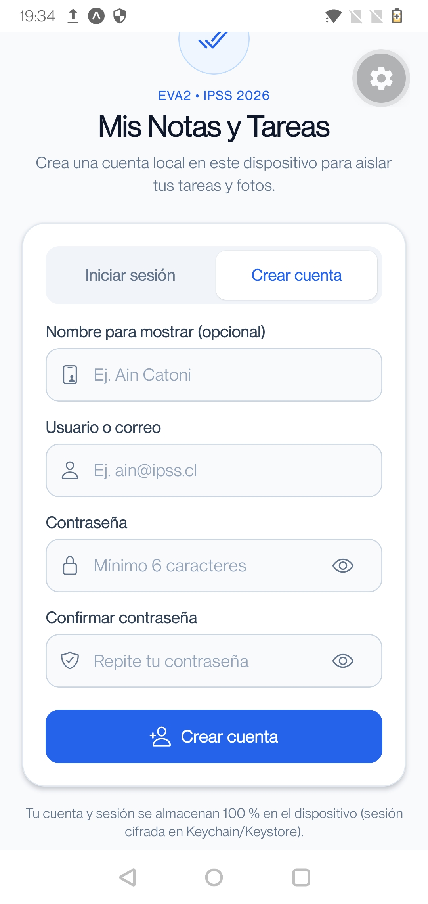 |
| **Aislamiento multiusuario (`R2`)**<br/>`emilys` ve solo su tarea con foto y GPS; `michaelw` inicia completamente aislado con 0 tareas. | 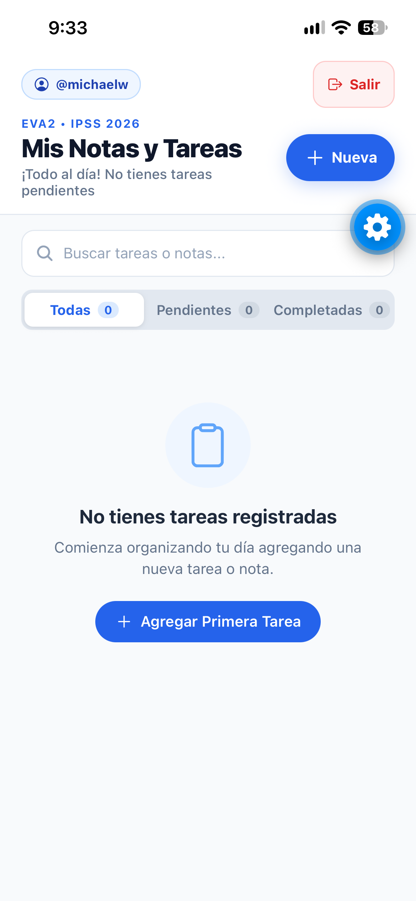 | 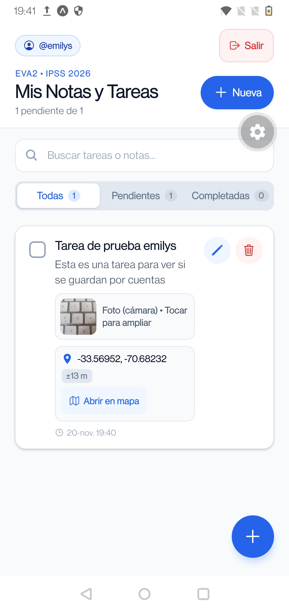 |
| **Continuidad 100 % Offline / Modo Avión (`R4`)**<br/>Con Modo Avión activo (ícono de avión en barra de estado), el login y la recuperación de tareas, foto y GPS operan sin red. | 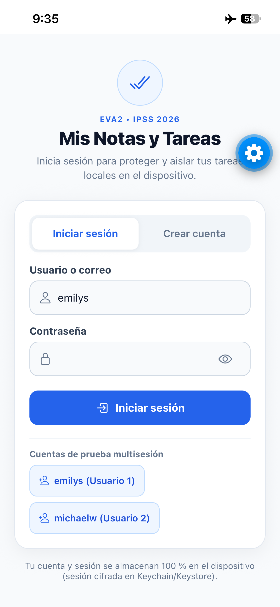 | 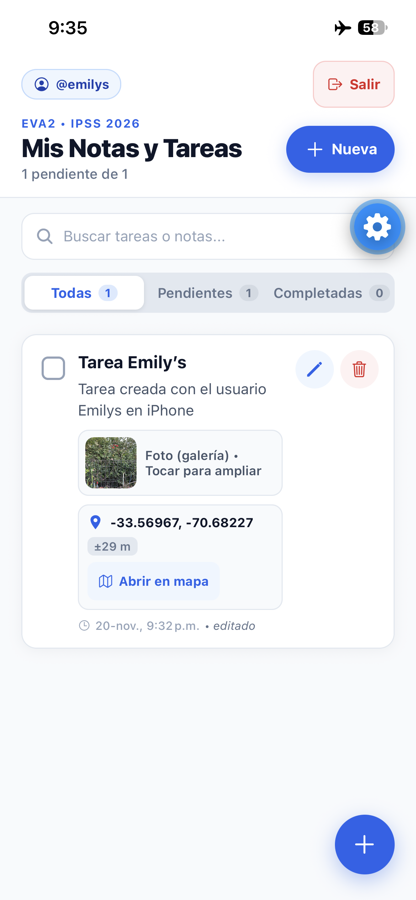 |

---

## 4. GESTIÓN INCREMENTAL DE PERMISOS NATIVOS (`R22`–`R25`)

Los permisos **nunca** se solicitan al abrir la aplicación. El flujo implementado en `permissionService.ts`, `expoPermissions.ts` y `usePermissions.ts` ejecuta un ciclo incremental bajo demanda:

```text
Acción del usuario (Cámara / Galería / GPS)
   └─► check() en SO
        ├─ granted ──────────────────────► Ejecuta recurso inmediatamente
        ├─ blocked (canAskAgain=false) ──► Modal "Bloqueado" + botón "Abrir ajustes" (Linking.openSettings)
        └─ undetermined / denied ────────► Modal propio Rationale ("Por qué lo necesitamos")
                                            ├─ "Ahora no" ──► denied (no invoca diálogo del SO)
                                            └─ "Continuar" ─► Diálogo nativo del SO
                                                               ├─ Concedido ──► Ejecuta recurso
                                                               └─ Denegado ───► Alternativa (galería / sin GPS) o blocked
```

### 4.1. Particularidades resueltas entre Android e iOS
* **Ubicación estrictamente en primer plano (`R25`):** en `app.json` y `expoPermissions.ts` solo se declara y solicita `whenInUse` (*«Mientras la app está en uso»*), evitando permisos en segundo plano.
* **Doble denegación en Android Expo Go (`R24`):** en Android, cuando el usuario rechaza dos veces un permiso, `Expo Go` puede seguir reportando `undetermined` en lugar de `canAskAgain = false`. Se implementó conteo compartido de denegaciones y sincronización pasiva mediante `AppState` (`active`) al regresar desde Ajustes del sistema.
* **Modales anidados en iOS:** `PermissionRationale` se renderiza como *overlay* absoluto con `accessibilityViewIsModal={true}` para evitar el bloqueo de modales nativos anidados propio de iOS.

### 4.2. Evidencias de permisos en dispositivos físicos

| Etapa del ciclo de permisos | Captura real | Comportamiento verificado |
| :--- | :---: | :--- |
| **Rationale de Ubicación (iPhone)** | 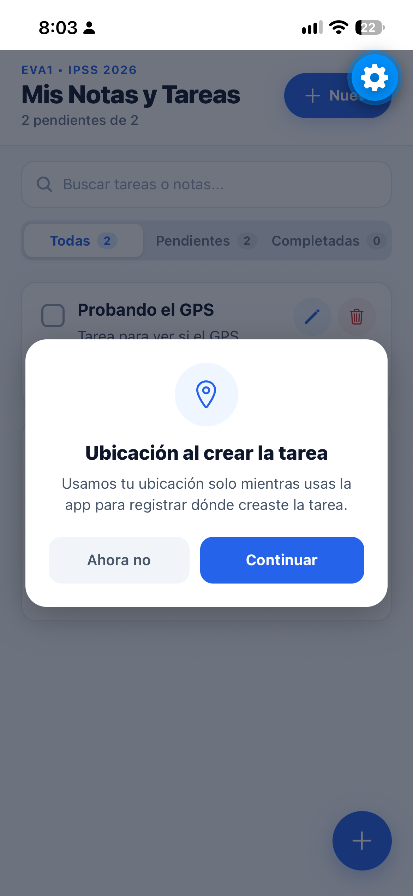 | Explicación previa en español antes del diálogo de iOS (`R23`). |
| **Rationale de Cámara (Android)** | 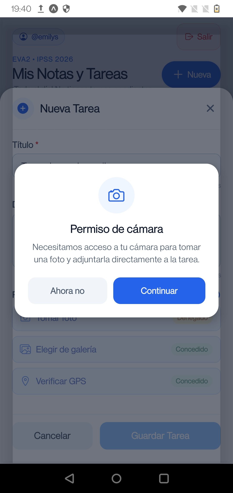 | Explicación previa contextual al pulsar «Tomar foto» (`R22`, `R23`). |
| **Diálogo Nativo `whenInUse` (Android)** | 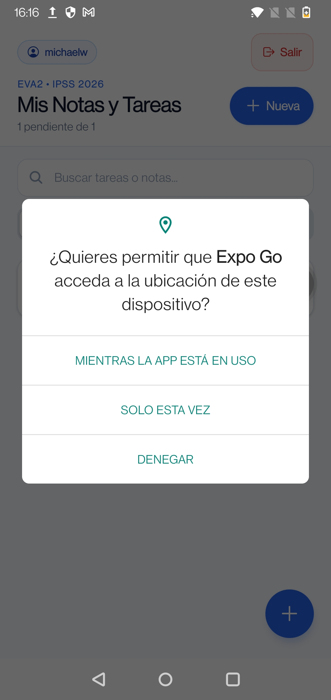 | Solicitud exclusivamente en primer plano (*«MIENTRAS LA APP ESTÁ EN USO»*, `R25`). |
| **Estado Bloqueado → Ajustes (Android)** | 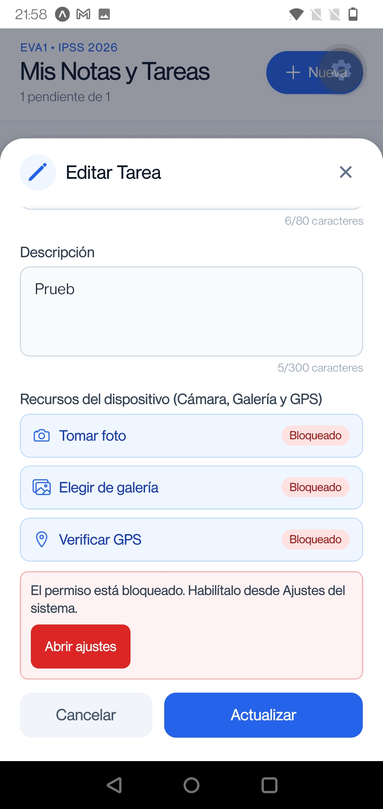 | Transición a `Bloqueado` con banner de alerta y acceso directo a Ajustes (`R24`). |

---

## 5. PERIFÉRICO CÁMARA, GALERÍA Y SISTEMA DE ARCHIVOS PRIVADO (`R7`, `R9`)

* **Captura y compresión:** `expoCamera.ts` utiliza `expo-image-picker` con `quality: 0.7` y `allowsEditing: false` para equilibrar nitidez y peso en disco.
* **Almacenamiento privado por usuario:** `fileSystemPhotos.ts` usa la API moderna de Expo SDK 58 (`File`, `Directory`, `Paths.document`) para copiar cada imagen desde caché temporal hacia `Paths.document/photos/<userId>/<taskId>-<timestamp>.jpg`. El sufijo temporal evita colisiones de caché al reemplazar una foto.
* **Limpieza automática de archivos (`R7`):** al quitar una foto, reemplazarla por otra o eliminar la tarea completa, `photoService.ts` borra físicamente el archivo anterior del directorio privado.
* **Degradación elegante (`R9`):** si el permiso de cámara es denegado, la app ofrece inmediatamente **«Elegir de galería»** como alternativa y siempre permite guardar la tarea sin foto.

| Modal con foto y metadatos (iPhone) | Visor ampliado `PhotoPreviewModal` (iPhone) | Tarjeta completada con foto + GPS (Android) |
| :---: | :---: | :---: |
| 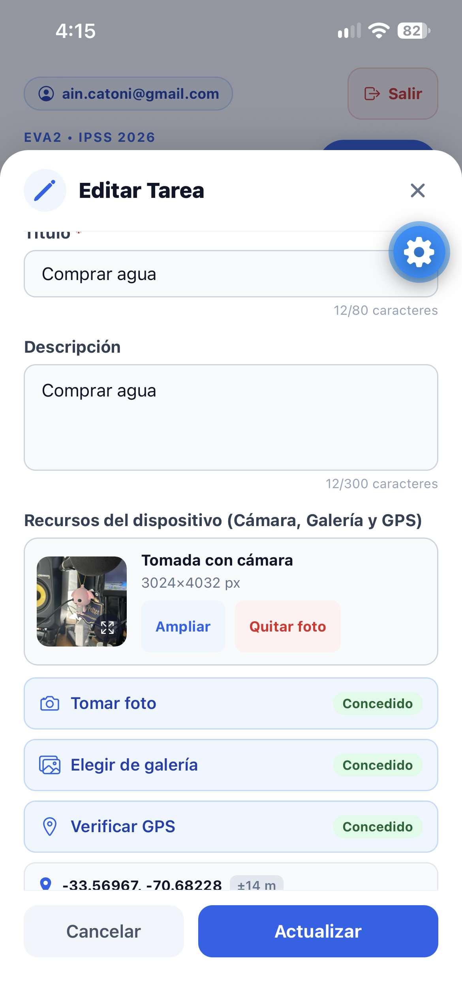 | 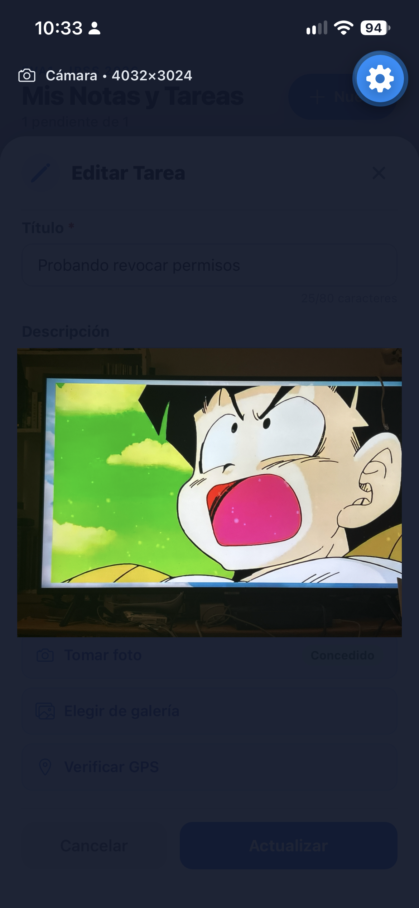 | 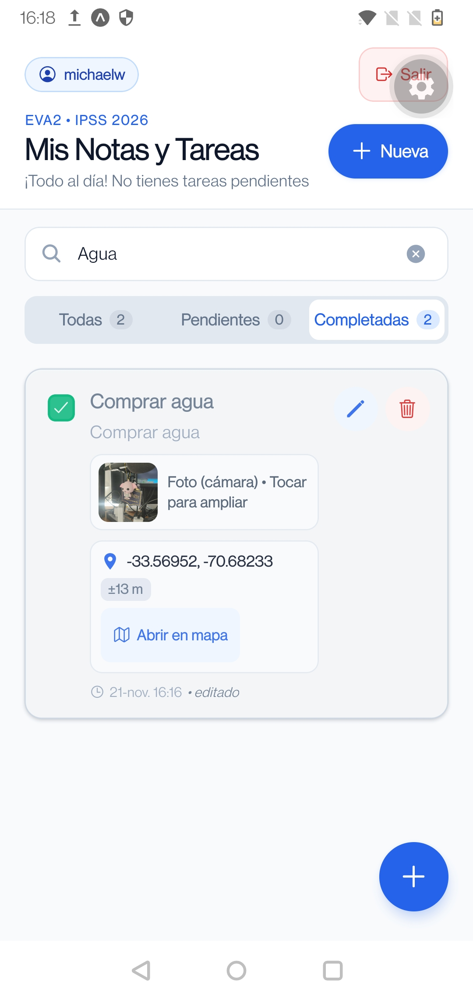 |

---

## 6. PERIFÉRICO GPS, PRECISIÓN, MAPAS Y OPTIMIZACIÓN (`R6`, `R8`)

### 6.1. Estrategia de captura no bloqueante y precisión
* **UI Optimista (`taskEnricher.ts`):** al guardar una tarea nueva, esta aparece al instante en la lista sin congelar la interfaz. En paralelo, `locationService.ts` solicita la posición con `Accuracy.Balanced` y un **timeout propio de `10 s`**, enriqueciendo la tarea sin sobrescribir ediciones posteriores ni revivir tareas borradas.
* **Resiliencia en Android:** `expoLocation.ts` solicita `enableNetworkProviderAsync()` cuando es necesario y aplica fallback con `watchPositionAsync` si `getCurrentPositionAsync` demora en interiores.
* **Inmutabilidad y degradación (`R6`, `R8`):** la ubicación se captura únicamente al crear la tarea (al editar permanece inmutable con la leyenda *«Registrada al crear (inmutable)»*). Si el GPS está apagado, denegado o excede los `10 s`, la tarea se guarda igualmente con `location = null`.
* **Enlace directo a Mapas del sistema (`LocationBadge.tsx`):** abre `maps.apple.com` en iOS y `geo:` (Google Maps) en Android con fallback web HTTPS, mostrando además aviso visual *«Baja precisión»* cuando `accuracy > 100 m`.

### 6.2. Tabla comparativa de lecturas GPS reales vs. Mapas del sistema

Mediciones reales capturadas desde la misma ubicación física en Santiago de Chile (interiores residenciales) comparando ambos dispositivos:

| Dispositivo | Sistema Operativo | Coordenadas capturadas | Precisión reportada | Comportamiento observado vs. Mapas del sistema |
| :--- | :--- | :---: | :---: | :--- |
| **iPhone** | iOS (Expo Go SDK 58) | `-33.56969, -70.68230` | **`±11 m`** *(rango `±11 m`–`±29 m`)* | Ubicación exacta sobre la calle en Apple Maps; primera fijación en < 2 s. |
| **OnePlus** | Android (Expo Go SDK 58) | `-33.56952, -70.68230` | **`±12 m`** *(rango `±12 m`–`±14 m`)* | Coincidencia directa en Google Maps (`12399 Los Alamos`, diferencia entre dispositivos < 19 m dentro del radio de precisión). |
| **OnePlus (GPS apagado)** | Android (prueba `R8`) | `null` (sin bloqueo) | — | La tarea *«Probando gps — Con el GPS apagado»* se crea al instante sin error ni congelamiento. |

| Precisión GPS `±11 m` (iPhone) | GPS apagado vs. activo `±14 m` (Android) | Apertura real en Google Maps (Android) |
| :---: | :---: | :---: |
| 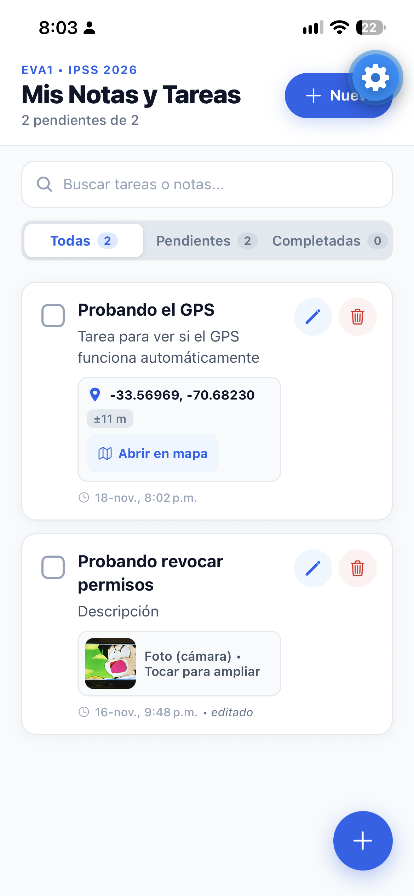 | 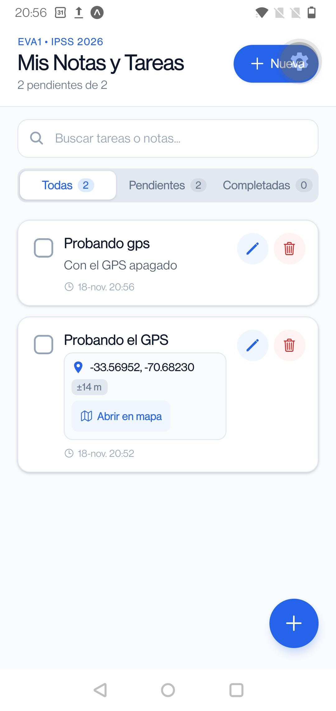 | 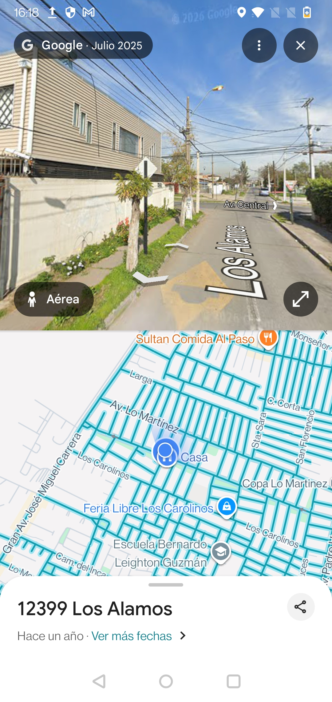 |

### 6.3. Optimizaciones de rendimiento, accesibilidad y seguridad (Fase 6)
* **`React.memo` y `FlatList`:** `TaskItem` envuelto en `React.memo`, `keyExtractor` y `renderTaskItem` memoizados con `useCallback`, y `FlatList` configurada con `initialNumToRender={10}`, `maxToRenderPerBatch={10}` y `windowSize={7}`.
* **Accesibilidad y ergonomía móvil:** todos los controles interactivos (`LoginScreen`, `Header`, `TaskItem`, `PhotoPicker`, `LocationBadge`, `PermissionRationale`, `PhotoPreviewModal`) cumplen áreas táctiles `>= 44 pt` (`minHeight: 44` o `hitSlop`) y poseen `accessibilityRole` y `accessibilityLabel` en español.
* **Auditoría de seguridad:** cero llamadas a `console.*` en código de producción, cero URLs `http://` fuera de pruebas unitarias que verifican su rechazo, y cero filtraciones de tokens en `AsyncStorage`.

---

## 7. METODOLOGÍA TDD Y PRUEBAS AUTOMATIZADAS

Todo el desarrollo de la Unidad 2 se ejecutó bajo **TDD estricto (`Red → Green → Refactor`)**: antes de implementar cada módulo de dominio, almacenamiento, permisos, cámara, GPS o autenticación, se escribieron las pruebas unitarias sobre los puertos usando dobles en memoria (`FakePermissions`, `FakeCamera`, `FakeLocation`, `FakePhotoFiles`, `FakeKeyValueStore`, `FakeSecureStore`, `FakeNetwork`, `FakeClock`, `SeqIdGenerator`).

### 7.1. Resumen de las 10 suites automatizadas (`155 pruebas`)

| Suite (`src/__tests__/`) | Reglas / Casos cubiertos | Pruebas | Estado |
| :--- | :--- | :---: | :---: |
| `taskLogic.test.ts` | Regresión completa de Unidad 1 (CRUD, filtros, búsqueda, métricas) | 13 | ✅ Pass |
| `validators.test.ts` | `Domain §6` — títulos, descripciones, usuarios/correos (`@`), contraseñas, coordenadas y DTOs | 42 | ✅ Pass |
| `errors.test.ts` | `Domain §7` — los 13 códigos `AppErrorCode`, mensajes en español y acciones tipadas | 16 | ✅ Pass |
| `taskStorage.test.ts` | `R2`, `Domain §8` — aislamiento `tasks_v2:<userId>`, migración única U1→U2, `users_v1`, `lastUser_v1` y JSON corrupto | 9 | ✅ Pass |
| `permissions.test.ts` | `R22`, `R23`, `R24`, `R25` — flujo incremental, rationale, cancelación, doble denegación Android, bloqueo→Ajustes y `whenInUse` | 10 | ✅ Pass |
| `camera.test.ts` | `R7`, `R9` — cámara, galería, guardado en directorio privado, reemplazo con borrado, cancelación y resultados malformados | 15 | ✅ Pass |
| `location.test.ts` | `R6`, `R8`, `R25` — coordenadas válidas/inválidas, timeout 10 s con `FakeClock`, baja precisión `> 100 m`, inmutabilidad y `taskEnricher` | 13 | ✅ Pass |
| `http.test.ts` | `R3` — rechazo `http://`, timeout, mapeo 4xx/5xx, `Authorization` solo a host propio y cero fugas de token en logs | 13 | ✅ Pass |
| `authApi.test.ts` | `CU-01` — `createLocalAuthApi` 100 % en dispositivo contra `users_v1` y contratos de `login`, `refresh`, `me` | 8 | ✅ Pass |
| `authService.test.ts` | `R1`–`R4b`, `CU-01`, `CU-01b`, `CU-02` — registro local, duplicados *case-insensitive*, re-login offline, `SecureStore`, refresh y logout | 12 | ✅ Pass |
| **Total** | **10 archivos de prueba — 527 aserciones `expect()`** | **155** | **✅ 100 % Pass** |

### 7.2. Salida real de `bun test --coverage`, `tsc` y `expo lint`

```text
$ bun test --coverage
-----------------------------------|---------|---------|-------------------
File                               | % Funcs | % Lines | Uncovered Line #s
-----------------------------------|---------|---------|-------------------
All files                          |   98.29 |   97.80 |
 src/api/authApi.ts                |  100.00 |   97.71 | 96,153,214,219,224
 src/domain/errors.ts              |  100.00 |  100.00 |
 src/domain/taskRules.ts           |  100.00 |  100.00 |
 src/domain/validators.ts          |  100.00 |   97.56 | 87-88
 src/services/authService.ts       |   96.77 |   98.61 | 329-331
 src/services/locationService.ts   |   90.00 |   97.62 | 60
 src/services/permissionService.ts |  100.00 |   98.81 |
 src/services/photoService.ts      |  100.00 |  100.00 |
 src/services/taskEnricher.ts      |  100.00 |   93.33 | 10
 src/storage/taskStorage.ts        |   96.15 |   94.41 | 54-57,134-137
-----------------------------------|---------|---------|-------------------
 155 pass | 0 fail | 527 expect() calls | Ran 155 tests across 10 files. [33.00ms]

$ bun --bun x tsc --noEmit   # 0 errores
$ bun --bun x expo lint      # 0 errores, 0 advertencias
```

### 7.3. Evidencia de metodología TDD en el historial Git (rama `unidad2`)

Cada fase funcional cuenta con su par de commits `test(...):` seguido de `feat(...):` después de validar en iPhone y Android:

| Commit | Tipo | Fase y alcance |
| :--- | :---: | :--- |
| `733eccc` | `chore` | Configuración Expo SDK 58, plugins de permisos en español, ESLint 9 y `bunfig.toml` |
| `75b802c` | `refactor` | **Fase 0:** extracción de `taskRules.ts` y puertos base sobre la Unidad 1 |
| `4398136` → `9139c9b` | `test` → `feat` | **Fase 1:** validadores, 13 códigos de error y `taskStorage` v2 aislado con migración U1→U2 |
| `8375258` → `d111a0d` | `test` → `feat` | **Fase 2:** permisos incrementales, rationale, bloqueo→Ajustes y check específico Android |
| `dacfb1b` → `b533362` | `test` → `feat` | **Fase 3:** cámara, galería, `expo-file-system` privado y visor ampliado `PhotoPreviewModal` |
| `2ab4c5f` → `6414658` | `test` → `feat` | **Fase 4:** GPS no bloqueante, timeout 10 s, precisión `±m`, `taskEnricher` y `LocationBadge` |
| `36d125b` → `5f5ade8` | `test` → `feat` | **Fase 5:** autenticación y registro local (`Crear cuenta`), `expo-secure-store` y multiusuario |
| `0edc8ca` | `perf` | **Fase 6:** optimización `React.memo`, `FlatList`, áreas táctiles `>= 44 pt` y accesibilidad |

---

## 8. PRUEBAS END-TO-END (E2E) EN DISPOSITIVOS FÍSICOS Y GUÍA DE EJECUCIÓN

### 8.1. Suite de pruebas End-to-End (E2E) ejecutadas en hardware real (iPhone + OnePlus)
Además de las **155 pruebas unitarias y de integración automatizadas** (`bun test`), cada fase fue validada mediante **pruebas End-to-End (E2E) manuales de punta a punta en dos teléfonos físicos reales** (**iPhone con iOS** y **OnePlus con Android**, ejecutando Expo Go SDK 58), cubriendo flujos completos de usuario, periféricos reales, permisos del sistema operativo y cortes de conectividad:

| ID | Flujo E2E ejecutado (paso a paso) | Resultado verificado y evidencia | iPhone (iOS) | OnePlus (Android) |
| :---: | :--- | :--- | :---: | :---: |
| **E2E-01** | **Registro local y re-ingreso (`CU-01b`):** abrir `LoginScreen` → pestaña *Crear cuenta* → registrar `ain.catoni@gmail.com` → entrar automáticamente → cerrar sesión (*Salir*) → volver a iniciar sesión con las credenciales creadas. | Cuenta persistida en `users_v1`, badge limpio en `Header` sin prefijo `@`, ingreso exitoso (`01`, `02`, `03`, `04`). | ✅ | ✅ |
| **E2E-02** | **Aislamiento multiusuario 3× (`R2`):** crear tarea en `ain.catoni@gmail.com` → salir → entrar con chip rápido `emilys (1)` y crear tarea con foto/GPS → salir → entrar con `michaelw (2)` → volver a `ain.catoni@gmail.com`. | Cada usuario visualiza exclusivamente sus tareas (`tasks_v2:<userId>`) y fotos; `michaelw` inicia con 0 tareas (`04`, `05`, `06`). | ✅ | ✅ |
| **E2E-03** | **Continuidad 100 % Offline / Modo Avión (`R4`):** activar Modo Avión (sin Wi-Fi ni datos móviles) → cerrar/reabrir e iniciar sesión con `emilys` → consultar tareas, foto privada y coordenadas GPS. | Autenticación local y sesión en `expo-secure-store` operan sin conexión; las fotos privadas y el GPS cargan intactos (`07`, `08`). | ✅ | ✅ |
| **E2E-04** | **Ciclo completo de permisos incrementales (`R22`–`R25`):** pulsar *Tomar foto*, *Elegir de galería* y *Verificar GPS* → revisar modal *rationale* → probar *Ahora no* (sin abrir diálogo del SO) → denegar permiso (alternativa de galería) → forzar bloqueo (`canAskAgain=false` / doble denegación Android) → abrir Ajustes → reactivar y volver a la app. | Solicitud exclusivamente bajo demanda y en primer plano (`whenInUse`); transición a `Bloqueado` con *Abrir ajustes* y resincronización automática vía `AppState` (`09`, `10`, `11`, `12`). | ✅ | ✅ |
| **E2E-05** | **Ciclo de vida de fotografía privada (`R7`, `R9`):** capturar foto con cámara y elegir desde galería → verificar miniatura y dimensiones (`3024×4032` iOS / `3456×4608` Android) → ampliar en `PhotoPreviewModal` → editar/quitar foto y eliminar tarea. | Imagen persistida en `Paths.document/photos/<userId>/`, visible en visor a pantalla completa y limpiada físicamente al quitar/borrar (`13`, `14`, `15`). | ✅ | ✅ |
| **E2E-06** | **GPS no bloqueante, degradación y Mapas (`R6`, `R8`):** crear tarea con GPS activo → validar guardado instantáneo y enriquecimiento con coordenadas + `±m` → editar tarea comprobando inmutabilidad → crear tarea con GPS apagado → pulsar *Abrir en mapa*. | Captura en segundo plano (`±11 m`–`±14 m`), inmutable al editar, degradación limpia a `location = null` con GPS apagado y apertura exacta en Apple Maps / Google Maps (`16`, `17`, `18`). | ✅ | ✅ |
| **E2E-07** | **Regresión CRUD, búsqueda, filtros y accesibilidad (Fase 6):** crear, completar (checkbox), editar, buscar en vivo (*«Agua»*), filtrar (*Todas / Pendientes / Completadas*) y eliminar con `Alert.alert` nativo. | Actualización inmediata con `React.memo`, áreas táctiles cómodas (`>= 44 pt`), sin cortes en barra de navegación inferior ni en Safe Area (`01`, `04`, `15`). | ✅ | ✅ |

### 8.2. Instalación, ejecución y cuentas de prueba

```bash
# 1. Instalar dependencias
bun install

# 2. Iniciar servidor Expo (escanear QR con Expo Go SDK 58 en iOS o Android)
bun start

# 3. Verificar pruebas TDD, cobertura, tipado y linter
bun test --coverage
bun --bun x tsc --noEmit
bun --bun x expo lint
```

**Cuentas pre-sembradas en el dispositivo** (accesibles también con los chips rápidos de `LoginScreen`):
* **Usuario 1:** `emilys` / `emilyspass`
* **Usuario 2:** `michaelw` / `michaelwpass`
* **Registro libre:** pestaña **«Crear cuenta»** para registrar cualquier nuevo alias o correo local.

### 8.3. Limitaciones conocidas
* En **Expo Go**, los permisos se muestran bajo el nombre de host *Expo Go* y algunas descripciones personalizadas de `app.json` se reflejan al compilar un *development/standalone build* con EAS (`eas build`).
* Las cuentas creadas con «Crear cuenta» son locales al dispositivo (no se replican entre teléfonos distintos), acorde al alcance offline de APIs internas definido para la Unidad 2.

---

## 9. DEMOSTRACIÓN EN VIDEO Y REFERENCIA UNIDAD 1

* 🎬 **Video Demostrativo Unidad 2 en iPhone (YouTube):** [https://youtube.com/shorts/jEDO7ZyLbK8](https://youtube.com/shorts/jEDO7ZyLbK8)
* 📦 **Entrega anterior (Unidad 1):** preservada íntegramente en el tag Git [`entrega-u1`](../../tree/entrega-u1) y sus capturas originales en [`Capturas/`](Capturas/).
  * Video demostrativo U1 en iPhone: [https://youtube.com/shorts/k3e_sxzy7Bc](https://youtube.com/shorts/k3e_sxzy7Bc)
  * Defensa técnica U1: [https://youtu.be/deRYQaMxEqs](https://youtu.be/deRYQaMxEqs)
