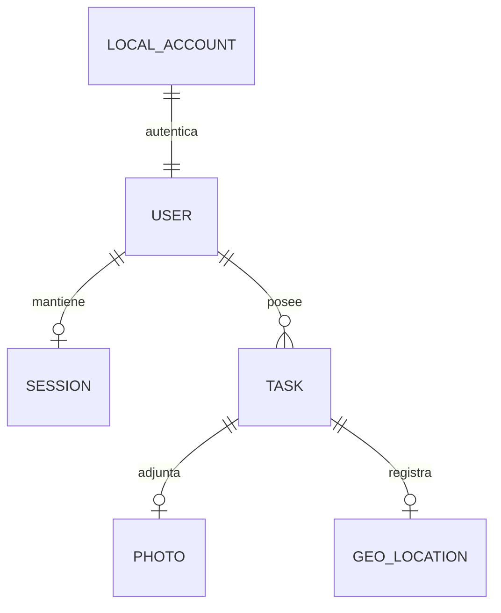

# todo-notes-app v2 — Dominio

> Lenguaje común, entidades, reglas de negocio, casos de uso, validaciones y persistencia local. Alcance actualizado a **APIs internas del dispositivo** (sin servicios web externos).

## 1. Lenguaje común

| Término | Significado |
|---|---|
| **Usuario** | Persona con cuenta local registrada o pre-sembrada en el dispositivo. Dueña exclusiva de sus tareas y fotos. |
| **Cuenta local** | Credencial almacenada localmente en el teléfono para habilitar registro e inicio de sesión multiusuario offline (`users_v1`). |
| **Sesión** | Sesión activa del usuario autenticada en el dispositivo y protegida en `expo-secure-store` (`session_v1`). Persiste entre aperturas de la app. |
| **Tarea** | Elemento de la lista (Unidad 1) extendido con `userId`, `photo` y `location`. |
| **Foto adjunta** | Imagen tomada con la cámara o seleccionada desde galería y copiada al directorio privado de la app (`expo-file-system`). |
| **Ubicación** | Coordenadas GPS (`latitude`, `longitude`, `accuracy`, `capturedAt`) capturadas únicamente **al crear** la tarea. |

## 2. Modelo de dominio

### 2.1 Entidades y objetos de valor

#### User
| Campo | Tipo | Nota |
|---|---|---|
| `id` | string | identificador único estable del usuario |
| `username` | string | único (case-insensitive), 3–30 caracteres (admite correo) |
| `displayName` | string | opcional |

#### LocalAccount (almacenamiento local `users_v1`)
| Campo | Tipo | Nota |
|---|---|---|
| `id` | string | id único asignado al registrar o cuenta semilla |
| `username` | string | nombre de usuario o correo |
| `password` | string | ≥ 6 caracteres (solo para validación local sin backend) |
| `displayName` | string | opcional |
| `createdAt` | number | epoch ms |

#### Session (`expo-secure-store` bajo `session_v1`)
| Campo | Tipo | Nota |
|---|---|---|
| `userId` | string | dueño de la sesión activa |
| `username` | string? | para mostrar `@username` inmediato al reabrir offline |
| `accessToken` | string | **solo en SecureStore** |
| `refreshToken` | string? | **solo en SecureStore** |
| `expiresAt` | number | epoch ms |

#### Task (extiende `src/types/task.ts` de la Unidad 1)
| Campo | Tipo | Nota |
|---|---|---|
| `id` | string | UUID/id local estable (clave de lista) |
| `userId` | string | dueño; filtra toda lectura/escritura |
| `title` | string | 1–80 caracteres tras `trim`, requerido |
| `description` | string | 0–500 caracteres |
| `completed` | boolean | estado pendiente / completada |
| `createdAt` / `updatedAt` | number | epoch ms |
| `photo` | `Photo \| null` | foto privada local |
| `location` | `GeoLocation \| null` | **inmutable** tras crear |
| `weather` | `WeatherSnapshot \| null` | reservado en modelo (`null`) |
| `remoteId` | `number \| null` | reservado en modelo (`null`) |
| `syncStatus` | `'pending' \| 'synced' \| 'error'` | estado interno del modelo (`'pending'`) |
| `source` | `'local' \| 'imported'` | origen (`'local'`) |
| `deletedAt` | `number \| null` | `null` en tareas activas |

#### Photo (objeto de valor)
`{ uri: string (file:// en directorio privado), width: number, height: number, takenWith: 'camera' | 'gallery' }`

#### GeoLocation (objeto de valor)
`{ latitude: number, longitude: number, accuracy: number | null, capturedAt: number }`  
Rangos válidos: latitud `−90..90`, longitud `−180..180`, ambos finitos.

### 2.2 Valores derivados
- `stats`: `{ total, completed, pending }` (heredado de U1).

## 3. Reglas de negocio e invariantes

**Sesión, registro y multiusuario**
- **R1.** Sin sesión válida no se accede a las tareas; solo se muestra la pantalla de *Iniciar sesión* / *Crear cuenta*.
- **R2.** Toda lectura y escritura de tareas y fotos filtra por `userId` (`tasks_v2:<userId>`, `photos/<userId>/...`). Cerrar sesión (`logout`) **no borra** tareas ni cuentas locales, pero sí elimina `session_v1` de `SecureStore`.
- **R3.** Los tokens/credenciales de sesión activa se guardan únicamente en `expo-secure-store` (`session_v1`); jamás en logs (`console.*`) ni en `AsyncStorage`.
- **R4.** Con sesión previa guardada en `SecureStore`, la app entra offline tras reiniciar incluso en modo avión o con `expiresAt` vencido.
- **R4b (Registro local — `CU-01b`).** Un usuario puede registrar una cuenta nueva en el dispositivo ingresando usuario (`validateUsername`), contraseña (`validatePassword`), confirmación coincidente y nombre visible opcional. Se rechaza cualquier usuario duplicado comparando en minúsculas (*case-insensitive*, incluidas las cuentas semilla `emilys` y `michaelw`), iniciando sesión automáticamente al crear la cuenta.

**Tareas, cámara y GPS**
- **R5.** `title` es obligatorio tras `trim` (1–80 caracteres); `description` es opcional (≤ 500 caracteres).
- **R6.** La ubicación se captura **solo al crear** la tarea (en segundo plano no bloqueante o mediante «Verificar GPS» antes de guardar). Editar no modifica ni elimina la ubicación original.
- **R7.** Foto: máximo una por tarea; al reemplazar o eliminar la foto o la tarea completa se elimina el archivo físico del directorio privado (`expo-file-system`).
- **R8.** Si la ubicación no está disponible (permiso denegado/bloqueado, GPS apagado o *timeout* de 10 s), la tarea **se crea igual** con `location = null` sin interrumpir al usuario.
- **R9.** Si el permiso de cámara está denegado o la cámara no está disponible, se ofrece «Elegir de galería» como alternativa; si ambos fallan, la tarea se crea sin foto.
- **R10.** La eliminación de tarea en el dispositivo borra físicamente la tarea de la lista y su fotografía asociada en disco.

**Permisos nativos**
- **R22.** Se solicitan **incrementalmente** justo cuando el usuario interactúa con la función: cámara al pulsar «Tomar foto», galería al pulsar «Elegir de galería», ubicación al pulsar «Verificar GPS» o al guardar una tarea nueva.
- **R23.** Antes del diálogo nativo del SO se presenta una explicación propia en español (*rationale*: «por qué necesitamos este permiso»); si el usuario pulsa «Ahora no», no se invoca el diálogo del sistema.
- **R24.** Estado `denied` con `canAskAgain = false` (o doble denegación en Android Expo Go) → transición a `blocked` con aviso claro y botón «Abrir ajustes» (`Linking.openSettings()`). Al regresar a la app (`AppState` active), se re-sincroniza el estado real desde el sistema operativo.
- **R25.** El permiso de ubicación se solicita **únicamente en primer plano** (`whenInUse`); está prohibido pedir ubicación en segundo plano.

*(Nota: las reglas R11–R21 de sincronización REST, importación desde API externa y clima Open-Meteo quedan fuera del alcance tras la indicación del docente de evaluar exclusivamente APIs internas del dispositivo).*

## 4. Permisos del sistema

| Recurso | Cuándo | Android | iOS (`Info.plist`) |
|---|---|---|---|
| Cámara | Al pulsar «Tomar foto» | `CAMERA` | `NSCameraUsageDescription` |
| Galería | Al pulsar «Elegir de galería» | Selector del sistema / `READ_MEDIA_IMAGES` | `NSPhotoLibraryUsageDescription` |
| Ubicación | Al verificar GPS o crear tarea | `ACCESS_COARSE_LOCATION` / `ACCESS_FINE_LOCATION` | `NSLocationWhenInUseUsageDescription` |

Todos los textos de permiso están configurados en español dentro de `app.json`.

## 5. Casos de uso

| ID | Caso | Flujo principal | Alternativos / Errores |
|---|---|---|---|
| `CU-01` | Iniciar sesión | Usuario/clave válidos → guarda sesión en `SecureStore` → entra a sus tareas | Credenciales inválidas, usuario/clave fuera de formato, cuentas rápidas `emilys` / `michaelw` |
| `CU-01b` | Crear cuenta local | Selector «Crear cuenta» → valida usuario, nombre opcional y contraseñas → guarda cuenta en `users_v1` e inicia sesión | Usuario ya existe, contraseñas no coinciden, formato inválido |
| `CU-02` | Cerrar sesión | Pulsa «Salir» → elimina tokens de `SecureStore` → vuelve a `LoginScreen` | Conserva tareas, fotos y cuentas locales del usuario |
| `CU-03` | Listar, buscar y filtrar | Muestra tareas del usuario activo; filtra (todas/pendientes/completadas) y busca en vivo | Estado vacío contextual |
| `CU-04` | Crear tarea | Título/desc. → foto opcional → guarda al instante → captura GPS en 2.º plano | Sin GPS o permiso denegado (`R8`), sin foto (`R9`) |
| `CU-05` | Adjuntar/cambiar foto | Cámara o galería → rationale → copia a directorio privado de usuario | Cancelado, denegado (galería alternativa), bloqueado → Ajustes |
| `CU-06` | Editar tarea | Modifica título/descripción/foto manteniendo ubicación original intacta (`R6`) | Validación título vacío |
| `CU-07` | Completar tarea | Alterna estado `completed` con recálculo inmediato de métricas | — |
| `CU-08` | Eliminar tarea | Diálogo de confirmación `Alert.alert` → elimina tarea y archivo de foto (`R7`) | Cancelar diálogo |
| `CU-11` | Ver detalle multimedia | Amplía foto en pantalla completa; muestra coordenadas + `±m` + «Abrir en mapa» | Aviso «baja precisión» si `accuracy > 100 m` |

## 6. Validaciones

| Campo | Regla | Mensaje |
|---|---|---|
| Título | 1–80 caracteres tras `trim` | `"Ingresa un título (máx. 80 caracteres)"` |
| Descripción | ≤ 500 caracteres | `"Máximo 500 caracteres"` |
| Usuario | 3–30 caracteres, `[a-zA-Z0-9._@-]` | `"Usuario inválido"` |
| Contraseña | ≥ 6 caracteres | `"Mínimo 6 caracteres"` |
| Confirmar contraseña | Igual a contraseña al crear cuenta | `"Las contraseñas no coinciden"` |
| Latitud / longitud | `-90..90` / `-180..180` y finitos | (interno) descarta lectura |

## 7. Errores de dominio (`src/types/errors.ts` y `src/domain/errors.ts`)

13 códigos tipados en `AppErrorCode`: `PERMISSION_DENIED`, `PERMISSION_BLOCKED`, `CAMERA_UNAVAILABLE`, `CAPTURE_CANCELLED`, `LOCATION_UNAVAILABLE`, `LOCATION_TIMEOUT`, `NETWORK_OFFLINE`, `NETWORK_TIMEOUT`, `AUTH_INVALID_CREDENTIALS`, `AUTH_EXPIRED`, `API_VALIDATION`, `API_SERVER`, `API_BAD_RESPONSE`, todos con mensaje en español claro y acción tipada (`retry | relogin | open_settings | ignore | inform`).

## 8. Persistencia local (claves en dispositivo)

| Clave / ruta | Contenido | Almacén |
|---|---|---|
| `tasks_v2:<userId>` | `Task[]` propias del usuario | `AsyncStorage` |
| `users_v1` | `LocalAccount[]` (semillas + cuentas creadas) | `AsyncStorage` |
| `lastUser_v1` | `{ id, username, displayName? }` (sin secretos) | `AsyncStorage` |
| `session_v1` | `{ user, session }` (tokens de sesión) | **`expo-secure-store`** (Keychain / Keystore) |
| `Paths.document/photos/<userId>/<taskId>-<ts>.jpg` | Fotografías privadas del usuario | `expo-file-system` |

**Migración v1 → v2:** al primer usuario que carga tareas, si existe la clave heredada de Unidad 1 (`@ipss_todo_app:tasks_v1`) y no fue migrada aún, se migran sus tareas reales excluyendo las semillas `seed-*`.
