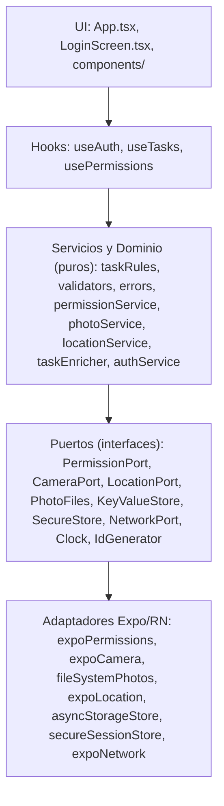

# todo-notes-app v2 — Stack tecnológico

> Tecnologías, arquitectura de Puertos y Adaptadores, convenciones y calidad. Alcance actualizado a **APIs internas del dispositivo**.

## 1. Resumen del stack

| Capa | Tecnología | Estado |
|---|---|---|
| Framework | React Native 0.88 + **Expo SDK 58** (React 19, Nueva Arquitectura) | Activo |
| Lenguaje | TypeScript (`strict`) | Activo |
| Estado UI | Custom Hooks (`useAuth`, `useTasks`, `usePermissions`) | Activo |
| Almacenamiento local | `@react-native-async-storage/async-storage` + `expo-file-system` (`File`, `Directory`, `Paths`) | Activo |
| Almacenamiento seguro | `expo-secure-store` (Keychain en iOS / Keystore en Android) | Activo |
| Cámara / Galería | `expo-image-picker` (`launchCameraAsync`, `launchImageLibraryAsync`) | Activo |
| GPS / Geolocalización | `expo-location` (`getCurrentPositionAsync`, `watchPositionAsync`, `enableNetworkProviderAsync`) | Activo |
| Conectividad | `expo-network` (detección de estado offline/online) | Activo |
| Pruebas y cobertura | `bun test --coverage` + `bunfig.toml` (umbral 80 %) | Activo |
| Linter y tipado | ESLint 9 (`eslint.config.js` / `bun --bun x expo lint`) + `bun --bun x tsc --noEmit` | Activo |

## 2. Equivalencia declarada: Ionic/Capacitor → React Native + Expo SDK 58

| Elemento del encargo | Equivalente implementado en Expo SDK 58 |
|---|---|
| `@capacitor/camera` | `expo-image-picker` (`quality: 0.7`, `allowsEditing: false`) |
| `@capacitor/geolocation` | `expo-location` (`Accuracy.Balanced` + timeout propio de `10 s` + fallback `watchPositionAsync`) |
| `@capacitor/preferences` | `@react-native-async-storage/async-storage` aislado por `userId` (`tasks_v2:<userId>`, `users_v1`) |
| `@capacitor/filesystem` | `expo-file-system` (`Paths.document/photos/<userId>/<taskId>-<ts>.jpg`) |
| Almacenamiento seguro de sesión | `expo-secure-store` (`session_v1` en Keychain/Keystore) |
| Pruebas unitarias Jest/Jasmine | `bun test` con patrón Puertos y Adaptadores y dobles de prueba (*fakes*) |

## 3. Módulos nativos Expo SDK 58 instalados

```bash
bunx expo install expo-image-picker expo-location expo-secure-store expo-file-system expo-network
```

Plugins configurados en `app.json` con textos de permiso en español:
- `expo-image-picker`: `cameraPermission`, `photosPermission`.
- `expo-location`: `locationWhenInUsePermission` (sin permiso de fondo).
- `expo-secure-store`: configuración nativa de almacenamiento cifrado.

## 4. Arquitectura (Puertos y Adaptadores)



La capa de dominio y servicios **no importa** `expo-*` ni `react-native`, lo que permite ejecutar toda la lógica de negocio y el manejo de errores en `bun test` en milisegundos usando *fakes* en memoria.

| Puerto (`src/ports/`) | Adaptador real (`src/adapters/`) | Doble de prueba (`src/__tests__/fakes/`) |
|---|---|---|
| `PermissionPort` | `expoPermissions.ts` | `FakePermissions.ts` |
| `CameraPort` | `expoCamera.ts` | `FakeCamera.ts` |
| `PhotoFiles` | `fileSystemPhotos.ts` | `FakePhotoFiles.ts` |
| `LocationPort` | `expoLocation.ts` | `FakeLocation.ts` |
| `KeyValueStore` | `asyncStorageStore.ts` | `FakeKeyValueStore.ts` |
| `SecureStore` | `secureSessionStore.ts` | `FakeSecureStore.ts` |
| `NetworkPort` | `expoNetwork.ts` | `FakeNetwork.ts` |
| `Clock` | `systemClock.ts` | `FakeClock.ts` |
| `IdGenerator` | `defaultIdGenerator.ts` | `SeqIdGenerator.ts` |
| `HttpClient` (opcional/unit tests) | `http.ts` | `fakeFetch.ts` |

La composición centralizada vive en `src/composition.ts`.

## 5. Estructura de carpetas actual y objetivo

```text
todo-notes-app/
├─ App.tsx                              # AuthGate (LoginScreen <-> Lista de Tareas)
├─ app.json                             # Plugins y descripciones de permisos en español
├─ bunfig.toml                          # coverageThreshold = 0.8 (domain/services/api/storage)
├─ eslint.config.js                     # ESLint 9 + eslint-config-expo
├─ Capturas/                            # Capturas U1 y U2 (por organizar U2 en Fase 7)
├─ docs/                                # Copia sincronizada de Brief, Domain, Stack y Plan
└─ src/
   ├─ types/                            # task.ts, auth.ts, errors.ts
   ├─ ports/                            # Interfaces de puertos
   ├─ domain/                           # validators.ts, taskRules.ts, errors.ts
   ├─ adapters/                         # expoCamera, expoLocation, expoPermissions, expoNetwork,
   │                                    # fileSystemPhotos, asyncStorageStore, secureSessionStore,
   │                                    # systemClock, defaultIdGenerator, http
   ├─ api/                              # authApi.ts
   ├─ storage/                          # taskStorage.ts (tasks por userId, migración U1, users_v1)
   ├─ services/                         # permissionService, photoService, locationService,
   │                                    # taskEnricher, authService
   ├─ hooks/                            # useAuth, useTasks, usePermissions
   ├─ screens/                          # LoginScreen.tsx (login + registro local en Fase 5)
   ├─ components/                       # Header, TaskFilterBar, TaskItem, TaskModal, EmptyState,
   │                                    # PermissionRationale, PhotoPicker, PhotoPreviewModal, LocationBadge
   ├─ composition.ts                    # Inyección de adaptadores reales
   └─ __tests__/
      ├─ fakes/                         # FakeCamera, FakeLocation, FakePermissions, FakePhotoFiles,
      │                                 # FakeKeyValueStore, FakeSecureStore, FakeNetwork, FakeClock,
      │                                 # SeqIdGenerator, fakeFetch
      ├─ builders/                      # aTask(), aLocation(), aSession()
      ├─ fixtures/                      # JSON de referencia para pruebas de parseo
      └─ *.test.ts                      # Suites TDD (10 archivos, 147+ pruebas)
```

## 6. Convenciones de optimización, seguridad y calidad

1. **Seguridad y privacidad**:
   - Tokens/sesión activa exclusivamente en `expo-secure-store` (`session_v1`); jamás en logs ni en `AsyncStorage`.
   - Permisos mínimos solicitados incrementalmente y ubicación solo en primer plano (`whenInUse`, `R25`).
   - Imágenes guardadas en el directorio privado de la aplicación y eliminadas del disco al reemplazar o borrar la tarea (`R7`).
   - Validación estricta de entradas en funciones puras antes de persistir (`validateTitle`, `validateDescription`, `validateUsername`, `validatePassword`, `validateCoordinates`).
2. **Optimización y experiencia móvil**:
   - Compresión de imagen (`quality: 0.7`) y nombres con marca de tiempo (`<taskId>-<ts>.jpg`) para evitar caché obsoleta al editar fotos.
   - Captura GPS no bloqueante (UI optimista vía `taskEnricher.ts`) y timeout de `10 s` para no congelar el guardado.
   - Modal dual con `KeyboardAvoidingView`, *overlays* compatibles con modal anidado en iOS (`PermissionRationale`, `PhotoPreviewModal`), limpieza de listeners `AppState` y `React.memo` en `TaskItem` (Fase 6).
   - Comandos de verificación en este entorno (sandbox macOS):
     - `bun test --coverage`
     - `bun --bun x tsc --noEmit`
     - `bun --bun x expo lint`
